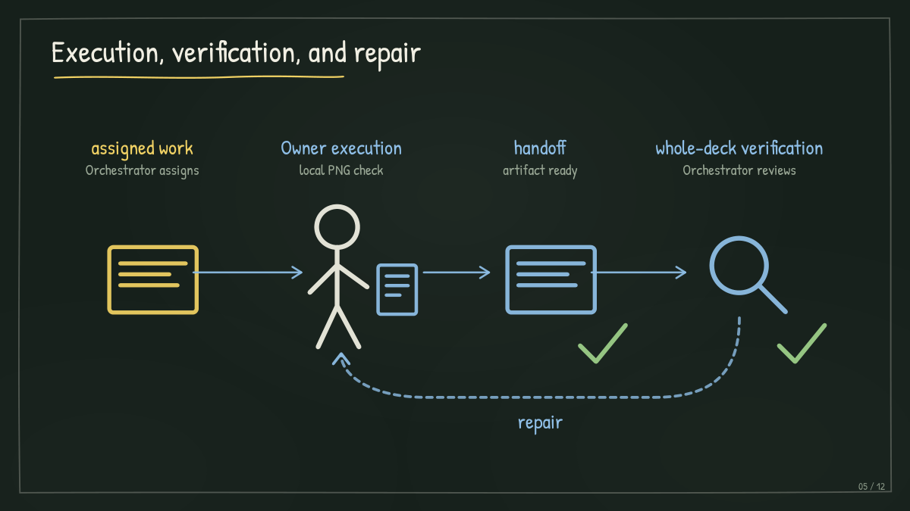
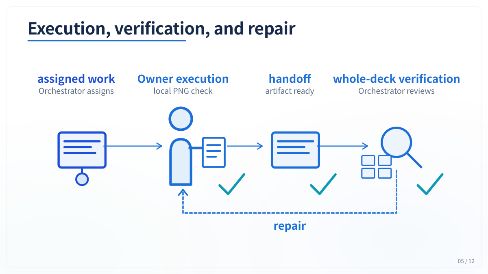

<a name="readme-en"></a>

<p align="center">
  <picture>
    <source media="(prefers-color-scheme: dark)" srcset="assets/logo/exports/street-v2/mural-banner-dark.png">
    
  </picture>
</p>

<h1 align="center"> MuralPresenter</h1>
<p align="center"><strong>Multi-Agent Units of Responsibility for<br>Authoring Long-Horizon Presentations</strong></p>
<p align="center">Editable HTML decks · Persistent page Owners · Visual inspection and revision</p>

<p align="center">
  <a href="#readme-en">English</a> ·
  <a href="#readme-zh">简体中文</a> ·
  <a href="#see-it-in-action">Examples</a> ·
  <a href="#quick-start">Quick start</a> ·
  <a href="webui/README_EN.md">WebUI</a> ·
  <a href="#method">Method</a> ·
  <a href="#results-at-a-glance">Results</a> ·
  <a href="#models-and-trajectory-training">Models</a> ·
  <a href="#evaluation">Evaluation</a> ·
  <a href="#release-status">Release status</a> ·
  <a href="#brand-assets">Brand assets</a>
</p>

**MuralPresenter turns a request and source materials into an editable HTML presentation,
with evidence grounding, visual inspection and follow-up revision.** It combines persistent
deck state with page Owners whose responsibility continues through production and editing.

This repository accompanies the paper and provides the authoring **Skill**, execution **Harness**
and **WebUI**. See [release status](#release-status) for the scope of the available artifacts.

## Overview

- **Adaptive responsibility.** Independent pages receive Single Owners; pages needing joint content or design adjustment share a Group Owner.
- **Persistent authoring.** Shared knowledge, plans and assets support local render–inspect–revise loops and deck-wide review.
- **Trajectory training and evaluation.** The paper studies 9B/27B models trained on execution segments, three public benchmarks and separate quality/process evaluation on 35 long-deck tasks.

<p align="center">
  <a href="assets/figures/ownership-workflow.png"></a>
</p>

<p align="center"><em>Shared deck state → Single / Group Owners → visual refinement → reviewed delivery.</em></p>

## See it in action

**The same deck, revised through its existing Owners.** The manuscript's qualitative case expands
a presentation of this paper from ten to twelve slides, then changes its blackboard styling to
light blue and white while refining diagrams. Below are pages 3 and 5 before and after revision.

<table>
  <tr><th width="50%">Before · Blackboard</th><th width="50%">After · Blue and white</th></tr>
  <tr>
    <td><a href="assets/figures/revision-case/before-03.png"></a></td>
    <td><a href="assets/figures/revision-case/after-03.png"></a></td>
  </tr>
  <tr>
    <td><a href="assets/figures/revision-case/before-05.png"></a></td>
    <td><a href="assets/figures/revision-case/after-05.png"></a></td>
  </tr>
</table>

[View all six before/after pairs](assets/figures/revision-case/README.md) ·
[Figure sources](assets/figures/README.md). These are manuscript exports, not a live WebUI demo;
the qualitative case is excluded from benchmark means.

## Quick start

Use Python 3.12 and `uv`. Provide your own model endpoint and credentials.

```bash
git clone https://github.com/G1nkgo7/MURAL-Presenter.git
cd MURAL-Presenter
uv sync --project webui/studio --frozen
uv sync --project webui/inference --frozen
test -f webui/.env || cp webui/.env.example webui/.env
bash webui/start.sh
```

Copy the example only on first setup; preserve an existing `.env`.
Open the address printed by the launcher, normally `http://127.0.0.1:8001`.
Configure the model in the UI or deployment environment. On Windows use `webui/start.ps1`.
The first launch can install Chromium. It creates ignored `configs/runtime.local.json`
without overwriting an existing configuration. Edit that file for concurrency and ordered
GPU/CPU MinerU endpoints, or select an existing file with `MURAL_RUNTIME_CONFIG`.
PDF/Office/image attachments require MinerU; text-only tasks do not require an attachment parser.
Search and image generation require separately configured providers.

**First task:** configure a model, create a case with your request and optional attachments,
follow the execution in the workspace, then inspect the deck preview and download the deliverables.
Use the [WebUI guide](webui/README_EN.md) for data paths, Docker, `/studio` deployment and troubleshooting.

## Command-line inference

```bash
webui/inference/.venv/bin/python scripts/run_inference.py \
  --query "Create a six-slide research presentation" \
  --workspace "$PWD/artifacts/example"
```

Use `--help` for arguments or `--doctor --json artifacts/doctor.json` for diagnostics.
Use a new workspace; preserve historical workspaces and their pinned runtime.

## Method

<details>
<summary>Responsibility units and cross-page dependencies</summary>

A whole-deck Owner retains one production history that grows with the presentation and its edits.
Per-slide Owners distribute production, while cross-page decisions require coordination between
separate contexts. MuralPresenter supports both single-page and multi-page units within one deck.
Topic or style similarity alone is insufficient for grouping: the relevant question is whether
content or design choices still need to be adjusted together.

<p align="center">
  
</p>

<p align="center"><em>Cross-page dependencies motivate a responsibility assignment that combines shared deck state with bounded page ownership.</em></p>

</details>

<details>
<summary>Agent roles, tools and handoffs</summary>

| Role | Responsibility |
| --- | --- |
| **Orchestrator** | Maintains shared knowledge and the blueprint, assigns units, reviews the deck and routes revisions; can also handle light research, routine assets and unassigned pages. |
| **Research** | Retrieves and synthesizes evidence, preserving sources, factual conditions and unresolved questions. |
| **Image** | Acquires or generates assets, inspects them and provides paths, intended uses, restrictions and target pages. |
| **Slide** | Authors HTML, inspects renders and repairs assigned pages; Single and Group Owners use the same authoring capabilities. |

Tools handle retrieval, file operations, asset processing and rendering. Agents make content and
design decisions. Handoffs carry artifact paths and usage information. Confirmed assets can reach
page Owners before the entire asset batch is ready.

<p align="center">
  
</p>

</details>

<details>
<summary>Authoring, responsibility assignment and revision</summary>

The current workflow figure shows six activities, which may overlap or recur:

1. **Knowledge Grounding:** resolve factual questions and record adopted evidence, conditions and open questions.
2. **Deck Planning:** establish the narrative, page briefs, notes, design rules and visual requests.
3. **Asset Preparation:** acquire or create visuals, inspect them and record their intended use.
4. **Delegate Page Units:** assign independent slides or coupled groups to their Owners.
5. **Parallel Authoring:** produce independent units as their shared inputs become ready, while preparation continues elsewhere.
6. **Iterative Refinement:** render, inspect and repair pages; review the assembled deck and route findings to the responsible Owners.

Content edits resume the relevant Owners. Structural edits can change units and ownership scopes.
Shared-style edits update the common state before affected pages are revised. Updated pages are
rendered and inspected again. Delivery assembles checked pages, assets and notes in deck order,
checks file completeness and exports the requested formats.

</details>

<details>
<summary>Editable HTML and export formats</summary>

MURAL uses HTML/CSS/SVG as its authoring source so that text, layout, graphics, media, and
interactions remain separately addressable. Browser rendering provides the pixel-level ground
truth for inspection, while the structured source supports targeted revision. PPTX, PDF, and
images are delivery adapters; export fidelity is evaluated rather than assumed.

</details>

## Models and trajectory training

The paper trains **MuralPresenter-9B** and **MuralPresenter-27B** on **9,000 quality-filtered
execution segments from 686 native source records**. These counts describe segments and sources,
not 9,000 completed presentations. Each segment keeps its preceding history as input context.

The public-benchmark checkpoints use **Global Selective**:

| Model | Backbone | Evaluated checkpoint |
| --- | --- | --- |
| MuralPresenter-9B | Qwen-3.5-9B | 4 epochs, 128 optimizer steps |
| MuralPresenter-27B | Qwen-3.8-27B | 2 epochs, 64 optimizer steps |

Model weights are not bundled with this source release.

<details>
<summary>Training recipe and supervision policies</summary>

| Supervision policy | Assistant actions receiving training loss |
| --- | --- |
| Full | Historical and current-segment actions. |
| Global Selective | Only current-segment actions, for every role. |
| Role-wise Selective | Current-segment actions for Slide; Full supervision for the other roles. |

Training uses MS-SWIFT, Megatron and BF16 with frozen vision encoders and mergers, a maximum
sequence length of 131,072 tokens and batch size 64. The supervision-policy comparison uses
four-epoch 27B models, distinct from the two-epoch 27B public-benchmark checkpoint.
These are paper experiment settings, not WebUI generation defaults. Model weights are not
bundled with this source release.

</details>

## Results at a glance

Scores below are transcribed from the current manuscript's public-benchmark tables, not new
runs of this repository. All four rows use the MuralPresenter authoring framework.

| Backbone / trained model | PresentBench Overall ↑ | SlidesGen Content (%) ↑ | SlidesGen Aesthetics ↑ |
| --- | ---: | ---: | ---: |
| Qwen-3.5-9B | 41.1 | 74.71 | 14.46 |
| **MuralPresenter-9B** | **47.3** | **90.21** | **18.38** |
| Qwen-3.8-27B | 69.4 | 93.33 | 18.58 |
| **MuralPresenter-27B** | **72.6** | **94.92** | **19.12** |

PresentBench covers 238 tasks; SlidesGen-Bench covers 189. The metrics use different scales.
Checkpoint selection and generation conditions matter; see [evaluation protocols](#evaluation).

<details>
<summary><strong>Analysis figures · responsibility workload and selective supervision</strong></summary>

**Responsibility workload.** Mean recorded production input and output tokens per task across
35 matched tasks, excluding shared preparation. Counts are lower bounds and do not measure
elapsed-time speedup.

<p align="center">
  <a href="assets/figures/responsibility-workload.png"></a>
</p>

**Selective supervision.** Global versus Full quality differences with paired 95% bootstrap
intervals, alongside input tokens by role. These exploratory results describe runs with differing
tool conditions; they do not isolate the effect of training.

<p align="center">
  <a href="assets/figures/supervision-ablation.png"></a>
</p>

</details>

## Evaluation

| Evaluation | Coverage in the manuscript | What it measures |
| --- | --- | --- |
| PresentBench | 238 tasks | Delivered presentation quality under task-specific rubrics. |
| SlidesGen-Bench | 189 tasks | Content accuracy and computational aesthetics. |
| DECKBench | 294 tasks, five editing turns each | Response to multi-turn editing through benchmark-defined similarity changes. |
| Internal long-deck tasks | 35 Chinese/English requests across six domains, requiring 20–40 pages | Long-deck final quality and separate process evidence. |

The internal evaluation separates quality and process. **Overall = 70% Deck + 30% Page**; Knowledge is part of Deck.
**Process** independently evaluates research support and adoption (**R**), executable planning
(**P**), asset preparation and actual-use handoffs (**I**), and plan realization, render inspection
and slide–speech alignment (**S**). Process is not included in Overall. The current process
analysis excludes criteria requiring authoring trajectories and includes formal and diagnostic
records. Missing compatible action records do not by themselves establish that an action was omitted.

<details>
<summary>Experiment protocols and interpretation</summary>

Interpret the experiments under their recorded protocols:

- Ten PresentBench tasks and ten internal long-deck tasks informed checkpoint selection and remain in the respective reported means. The complete selection history has not been reconstructed.
- DECKBench imports preceding artifacts into a fresh workspace each turn, evaluating artifact continuity rather than persistent Owner history.
- Adaptive and per-slide ownership achieve similar mean Overall scores; both use more recorded production work than whole-deck ownership. The study does not establish elapsed-time speedup.
- Search availability, image services and quotas differ across the supervision-study runs, limiting causal attribution to the training policy.

</details>

## Brand assets

The standalone mark, avatar and painter mascot share the banner’s street-mural identity. Click a preview to open its original PNG.

<table>
  <tr><th width="33%">Primary mark · Transparent</th><th width="33%">Avatar · Circular badge</th><th width="33%">Painter mascot · Transparent</th></tr>
  <tr><td align="center"><a href="assets/logo/exports/street-v2/mural-mark.png"></a></td><td align="center"><a href="assets/logo/exports/street-v2/mural-avatar-circle.png"></a></td><td align="center"><a href="assets/logo/exports/street-v2/mural-mascot.png"></a></td></tr>
</table>

<details>
<summary>Wordmarks and paper sharing card</summary>

<p align="center">
  <picture>
    <source media="(prefers-color-scheme: dark)" srcset="assets/logo/exports/street-v2/mural-wordmark-dark.png">
    
  </picture>
</p>

The wordmark follows your reader’s light or dark theme.

<p align="center">
  <a href="assets/logo/exports/street-v2/mural-social-card.png"></a>
</p>

[Light wordmark](assets/logo/exports/street-v2/mural-wordmark-light.png) · [Dark wordmark](assets/logo/exports/street-v2/mural-wordmark-dark.png) · [Paper sharing card](assets/logo/exports/street-v2/mural-social-card.png)

</details>

See the [brand guide](assets/logo/exports/street-v2/README.md) for the full asset set, usage and version history.

## Release status

| Artifact | Availability |
| --- | --- |
| Authoring Skill and Harness | Included: frozen 0919 source pair, verified against its original inventory. |
| WebUI and launchers | Included: portable configuration, CLI and `/studio` deployment support. |
| Public logos and method figures | Included: [street-mural brand kit](assets/logo/exports/street-v2/README.md) and [figure provenance](assets/figures/README.md). |
| 9B / 27B model weights | Not included; no public checkpoint download is linked yet. |
| Training data, internal evaluation cases and evaluation pipelines | Not included in this runtime release. |
| Paper link and citation metadata | Awaiting final author-supplied publication metadata. |

The runtime source pin and trained model checkpoints are separate version identities.
The 0919 source pin does not establish that every later paper experiment used an identical
runtime and configuration.

<details>
<summary>What is needed to reproduce paper scores?</summary>

Score reproduction additionally requires exact inputs and checksums, weights and chat templates,
evaluation adapters, font shims, Judge settings and output-selection/coverage records.
The original evaluation font inventory was larger than this repository's font bundle.
Running the application or passing source checks does not reproduce the paper's scores.

</details>

## Repository layout

```text
MURAL-Presenter/
├── README.md / README_zh-CN.md
├── skills/mural-presenter-v1/       # Frozen authoring Skill and tools
├── harnesses/mural-presenter-v1/    # Frozen inference and delivery runtime
├── webui/                          # UI, server, dependency locks and launchers
├── assets/                         # Public logos, icons and method diagrams
├── configs/                        # Runtime template, MinerU and release provenance
├── fonts/                          # Bundled rendering fonts
├── scripts/                        # Portable CLI and configuration adapters
├── tools/                          # Source verification and integration freezing
├── tests/                          # Public integration regression tests
└── .github/                        # CI and contribution templates
```

The core directory names and internal assets, references, docs and tests are part of its frozen
identity. Keep them intact. Public logos and diagrams live in `assets/logo/exports/` and
`assets/figures/`; [figure provenance](assets/figures/README.md) records the current manuscript exports.
Design drafts remain local. Root-level `benchmark/`, `docs/`, `examples/`,
`paper/`, training material and the independent `site/` are not included in this release.
Deployment credentials, environments, databases and generated cases remain local and ignored.
Necessary usage, provenance and validation information is consolidated in these READMEs.

## Versioning and validation

The 254 core files retain the 0919 source snapshot
`mural-presentbench-qwen35-9b-20260919T163556Z`. Deployment paths are resolved at launch;
portable integration updates are recorded separately in `configs/releases/mural-paper-v1.json`.

```bash
python tools/check_paper_release.py
```

See [Contributing](CONTRIBUTING.md) for the source and manifest workflow, and
[packaging CI](.github/workflows/public-surface.yml) for the tested scope.

<details>
<summary>Source inventory and hash verification</summary>

The active manifest is `configs/releases/mural-paper-v1.json`.
`configs/releases/upstream-0919/` retains the original 319-file publication inventory,
its pin and its release hashes. Historical inventory entries record provenance; they do not
require publishing the original internal pipeline configurations or benchmark scripts.

All 55 Skill and 199 Harness files retain the original combined SHA-256:
`378c3ac7fa26d06b91f5408c7a25e7350b9b37e712611a322e387ae13a2d64e3`.
Historical examples and links inside that frozen source may refer to the original environment;
use this README's portable launch instructions. Two unreadable upstream WebUI tests were not
imported. The portable integration has a separate release identity and digest.

```bash
python tools/check_paper_release.py
```

This verifies the frozen core, active integration and tracked release boundaries.
Do not refresh core hashes to conceal source changes. Integration updates require their own
review, tests and manifest; see [Contributing](CONTRIBUTING.md).

</details>

<details>
<summary>Validation record and known limits</summary>

CI commands are in [.github/workflows/public-surface.yml](.github/workflows/public-surface.yml).
They cover portable configuration, HTTP and `/studio` routing, release/configuration contracts,
and active WebUI configuration. Use isolated test data, not an existing Studio database.

The compact public tree was checked on Linux on 2026-10-10: 10 portable/source-digest tests,
95 release/configuration tests and 139 WebUI tests passed; one browser test was skipped.
The example launcher preflight passed. These checks used an isolated Git worktree and existing
locked-dependency test environments, without model requests or production data.

The complete historical suite has not passed. The frozen source retains these known failures:

- `test_agent_runtime.py::test_resume_preserves_inspect_feedback_as_tool_context_without_reconciliation`:
  resumed tool content is a string where the assertion expects text/image parts.
- `test_creation_config_runtime.py::test_presentation_change_requires_new_render_and_real_visual_consumption`:
  the second inspection returns `inspection_limit_reached` after a language change.

Two historical tests cannot collect without unpublished canary modules
(`test_real_webui_canary.py`, `test_refero_font_audit.py`); some legacy WebUI tests require archived
runtimes. Packaging CI deliberately selects its documented scope. Docker builds, Windows/macOS
startup and the complete 238-case experiment have not been validated by these packaging checks.
Local deployment smoke tests are not paper-score reproduction.

</details>

## License and citation

Project-wide licensing awaits confirmation by the rights holders. Third-party terms remain
applicable; see [third-party notices](webui/THIRD_PARTY_NOTICES.md) and [font records](fonts/FONTS.md).
Final authors, paper URL/DOI, citation metadata and the immutable paper tag remain to be confirmed.

---

<!-- BEGIN HOMEPAGE ZH-CN -->
<a name="readme-zh"></a>

<h2 align="center">简体中文</h2>
<p align="center">可编辑 HTML 演示文稿 · 持续负责的页面 Owner · 视觉检查与修订</p>

<p align="center">
  <a href="#readme-en">English</a> ·
  <a href="#readme-zh">简体中文</a> ·
  <a href="#生成与修改示例">效果示例</a> ·
  <a href="#安装与启动">快速启动</a> ·
  <a href="webui/README.md">WebUI</a> ·
  <a href="#方法详解">方法</a> ·
  <a href="#实验结果速览">实验结果</a> ·
  <a href="#模型与轨迹训练">模型</a> ·
  <a href="#评测">评测</a> ·
  <a href="#发布状态">发布状态</a> ·
  <a href="#品牌素材">品牌素材</a>
</p>

**MuralPresenter 根据需求和来源材料制作可编辑 HTML 演示文稿，支持证据整理、视觉检查和后续修改。**
系统持续维护整册状态，让页面 Owner 在制作与修改中保留明确的责任范围。

本仓库配套论文，提供创作 **Skill**、执行 **Harness** 和 **WebUI**；
各项制品的当前可用范围见[发布状态](#发布状态)。

## 项目概览

- **自适应责任分配**：独立页面交给 Single Owner，需要共同调整内容或设计的页面交给 Group Owner。
- **持续创作与修改**：共享知识、规划和素材支撑局部渲染检查、定向修订与整册复审。
- **轨迹训练与评测**：论文研究基于执行片段训练的 9B/27B 模型、三个公共 benchmark，以及 35 个长演示任务的独立质量与过程评测。

<p align="center">
  <a href="assets/figures/ownership-workflow.png"></a>
</p>

<p align="center"><em>共享整册状态 → Single / Group Owner → 视觉检查与修订 → 复审后交付。</em></p>

## 生成与修改示例

**同一份演示文稿，由原有 Owner 继续修改。** 论文中的定性案例先将介绍本论文的演示文稿从
10 页扩展到 12 页，再从黑板风格改为浅蓝白色，并调整解释性图示。下方展示第 3、5 页的修改前后对照。

<table>
  <tr><th width="50%">修改前 · 黑板风格</th><th width="50%">修改后 · 浅蓝白色</th></tr>
  <tr>
    <td><a href="assets/figures/revision-case/before-03.png"></a></td>
    <td><a href="assets/figures/revision-case/after-03.png"></a></td>
  </tr>
  <tr>
    <td><a href="assets/figures/revision-case/before-05.png"></a></td>
    <td><a href="assets/figures/revision-case/after-05.png"></a></td>
  </tr>
</table>

[查看全部六组前后对照](assets/figures/revision-case/README.md) · [配图来源](assets/figures/README.md)。
这些图片直接导出自论文附录，不是在线 WebUI 演示；该定性案例不计入 benchmark 均值。

## 安装与启动

需要 Python 3.12、uv，以及自己的模型服务和凭据。

```bash
git clone https://github.com/G1nkgo7/MURAL-Presenter.git
cd MURAL-Presenter
uv sync --project webui/studio --frozen
uv sync --project webui/inference --frozen
test -f webui/.env || cp webui/.env.example webui/.env
bash webui/start.sh
```

仅首次部署复制示例配置；已有 `.env` 应保留。打开启动器打印的地址，默认
`http://127.0.0.1:8001`。模型可在 WebUI 或部署环境中配置；Windows 使用 `webui/start.ps1`。
首次启动可能下载 Chromium。启动器生成被忽略的 `configs/runtime.local.json`，不会覆盖已有配置。
在其中设置并发及按顺序排列的 MinerU GPU/CPU 服务地址，或用 `MURAL_RUNTIME_CONFIG` 指定已有文件。
PDF、Office、图片附件解析需要 MinerU；纯文本任务不需要附件解析服务。搜索和生图服务分别配置。

**第一个任务**：配置模型，创建 case 并填写需求和可选附件，在工作区查看执行过程，
然后检查演示文稿预览并下载产物。
数据路径、Docker、`/studio` 子路径部署与排错见 [WebUI 使用说明](webui/README.md)。

## 命令行推理

```bash
webui/inference/.venv/bin/python scripts/run_inference.py \
  --query "制作一份六页的研究介绍演示" \
  --workspace "$PWD/artifacts/example"
```

使用 `--help` 查看参数，或用 `--doctor --json artifacts/doctor.json` 生成诊断报告。
新任务使用新工作区；保留历史工作区及其固定的运行版本。

## 方法详解

<details>
<summary>责任单元与跨页依赖</summary>

一个 Owner 制作整册时，其制作历史会随页面与修改不断增长。逐页分配 Owner 可以分散制作任务，
跨页决策则需要在独立上下文之间协调。MuralPresenter 在同一份演示文稿中同时支持单页和多页单元。
分组依据是内容或设计决策是否仍需共同调整；仅仅主题相同或风格相似，并不足以决定分组。

<p align="center">
  
</p>

<p align="center"><em>跨页依赖要求制作责任同时具备共享整册状态与明确的局部范围。</em></p>

</details>

<details>
<summary>Agent 角色、工具与任务交接</summary>

| 角色 | 职责 |
| --- | --- |
| **Orchestrator** | 维护共享知识与蓝图，分配责任单元，复审整册并路由修改；也可处理轻量研究、常规素材与尚未分配的页面。 |
| **Research** | 检索和综合证据，保留来源、事实成立条件与未解决问题。 |
| **Image** | 获取或生成素材，进行视觉检查，交接路径、用途、限制和目标页面。 |
| **Slide** | 制作 HTML、检查渲染并修复所负责页面；Single Owner 和 Group Owner 使用同一套创作能力。 |

工具执行检索、文件操作、素材处理和渲染，Agent 决定内容与设计。任务通过文件路径和使用说明交接。
已经确认可用的素材可以先交给页面 Owner，无需等待全批次素材完成。

<p align="center">
  
</p>

</details>

<details>
<summary>创作、责任分配与修改流程</summary>

当前流程图展示六项可重叠、可重复进入的活动：

1. **Knowledge Grounding（知识奠基）**：解决事实问题，记录采纳的证据、成立条件与开放问题。
2. **Deck Planning（整册规划）**：确定叙事、页面 brief、讲稿、设计规则与视觉需求。
3. **Asset Preparation（素材准备）**：获取或生成视觉素材，检查并记录使用方式。
4. **Delegate Page Units（分配页面单元）**：将独立页面或需要共同调整的页面组交给对应 Owner。
5. **Parallel Authoring（并行创作）**：各独立单元在输入就绪后开始制作，其他页面的准备工作可以继续。
6. **Iterative Refinement（迭代修订）**：渲染、检查和修复页面，复审整册，并将发现的问题交给对应 Owner。

内容修改由相关 Owner 继续处理；结构修改可以调整责任单元和归属；共享风格修改先更新公共状态，
再修改受影响页面。修改后的页面重新渲染和检查。交付阶段按整册顺序汇总已检查的页面、素材和讲稿，
验证文件完整性，并导出所需格式。

</details>

<details>
<summary>可编辑 HTML 与导出格式</summary>

MURAL 以 HTML/CSS/SVG 作为创作源，使文字、布局、图形、媒体与交互保持独立可寻址。
浏览器渲染提供像素级检查依据，结构化源码则支持定向修改。PPTX、PDF 和图片是交付适配层，
不同格式的导出保真度需要实际评估，而不是默认等价。

</details>

## 模型与轨迹训练

论文基于 **686 条原生源记录中的 9,000 个质量筛选后执行片段**，训练
**MuralPresenter-9B** 与 **MuralPresenter-27B**。这些数字表示片段和源记录数量，
并不表示生成了 9,000 份完整演示文稿。每个片段保留此前历史作为输入上下文。

公开 benchmark 主实验使用 **Global Selective** checkpoint：

| 模型 | 基座 | 评测 checkpoint |
| --- | --- | --- |
| MuralPresenter-9B | Qwen-3.5-9B | 4 epochs，128 个优化步 |
| MuralPresenter-27B | Qwen-3.8-27B | 2 epochs，64 个优化步 |

本次源码发布不附带模型权重。

<details>
<summary>训练设置与监督策略</summary>

| 监督策略 | 参与训练损失计算的 Assistant 动作 |
| --- | --- |
| Full | 历史动作和当前片段动作。 |
| Global Selective | 所有角色都只监督当前片段动作。 |
| Role-wise Selective | Slide 只监督当前片段动作，其他角色采用 Full。 |

训练使用 MS-SWIFT、Megatron 和 BF16，冻结视觉编码器与 merger，最大序列长度为 131,072 tokens，
batch size 为 64。监督策略对比使用训练 4 轮的 27B 模型，与主实验的 2 轮 27B checkpoint 不同。
以上是论文实验设置，不是 WebUI 的生成默认值。本次源码发布不附带模型权重。

</details>

## 实验结果速览

下表摘自当前论文的公共 benchmark 结果，并非本次更新重新运行所得。四行均使用 MuralPresenter 创作框架。

| 基座／训练后模型 | PresentBench Overall ↑ | SlidesGen 内容准确率 (%) ↑ | SlidesGen 美学总分 ↑ |
| --- | ---: | ---: | ---: |
| Qwen-3.5-9B | 41.1 | 74.71 | 14.46 |
| **MuralPresenter-9B** | **47.3** | **90.21** | **18.38** |
| Qwen-3.8-27B | 69.4 | 93.33 | 18.58 |
| **MuralPresenter-27B** | **72.6** | **94.92** | **19.12** |

PresentBench 覆盖 238 个任务，SlidesGen-Bench 覆盖 189 个任务，各项指标的量纲不同。
理解结果时需结合 checkpoint 选择与生成条件，详见[评测协议](#评测)。

<details>
<summary><strong>分析配图 · 责任分配工作量与选择性监督</strong></summary>

**责任分配工作量。** 35 个匹配任务中，每个任务制作阶段记录到的输入与输出 token 均值，不含共享准备阶段。
统计值是下界，不能据此推断实际耗时加速。

<p align="center">
  <a href="assets/figures/responsibility-workload.png"></a>
</p>

**选择性监督。** Global 相对 Full 的质量变化及配对 95% bootstrap 区间，以及各角色输入 token。
这些探索性结果来自工具条件存在差异的运行，不能单独归因为训练策略。

<p align="center">
  <a href="assets/figures/supervision-ablation.png"></a>
</p>

</details>

## 评测

| 评测 | 当前论文覆盖范围 | 评测内容 |
| --- | --- | --- |
| PresentBench | 238 个任务 | 按任务专属 rubric 评估交付演示文稿的质量。 |
| SlidesGen-Bench | 189 个任务 | 内容准确率与计算美学。 |
| DECKBench | 294 个任务，每个任务修改 5 轮 | 使用 benchmark 定义的相似度变化衡量多轮编辑结果。 |
| 内部长演示任务 | 6 个领域的 35 个中英文请求，每个要求 20–40 页 | 分别评估长演示文稿的最终质量与过程证据。 |

内部评测分别报告质量与过程。**Overall = 70% Deck + 30% Page**，Knowledge 属于 Deck。
**Process** 独立评估研究支持与采纳（**R**）、可执行规划（**P**）、素材准备与实际使用交接（**I**），
以及计划落地、渲染检查和讲稿与页面对应（**S**）。Process 不计入 Overall。当前过程分析排除了
依赖创作轨迹的评分条目，包含正式和诊断记录；缺少兼容动作记录，本身不能证明 Agent 没有执行对应动作。

<details>
<summary>实验协议与结论适用范围</summary>

实验结论应结合论文记录的协议理解：

- PresentBench 的 10 个任务及内部长演示任务中的 10 个任务参与了 checkpoint 选择，并保留在各自报告均值中；完整选择历史尚未重建。
- DECKBench 每轮把上一轮产物导入新工作区，测试产物延续性，没有测试 Owner 历史的持续保留。
- 自适应与逐页分配的 Overall 均值接近，二者记录到的制作工作量都高于整册单 Owner；实验未建立耗时加速结论。
- 监督策略实验中的搜索可用性、生图服务和配额存在差异，限制了将结果变化单独归因于训练策略。

</details>

## 品牌素材

独立标识、头像与画家吉祥物沿用顶部横幅的壁画风格。点击图片可打开原始 PNG。

<table>
  <tr><th width="33%">主标识 · 透明背景</th><th width="33%">头像 · 彩色圆形徽章</th><th width="33%">画家吉祥物 · 透明背景</th></tr>
  <tr><td align="center"><a href="assets/logo/exports/street-v2/mural-mark.png"></a></td><td align="center"><a href="assets/logo/exports/street-v2/mural-avatar-circle.png"></a></td><td align="center"><a href="assets/logo/exports/street-v2/mural-mascot.png"></a></td></tr>
</table>

<details>
<summary>字标与论文分享图</summary>

<p align="center">
  <picture>
    <source media="(prefers-color-scheme: dark)" srcset="assets/logo/exports/street-v2/mural-wordmark-dark.png">
    
  </picture>
</p>

字标随阅读器深浅色主题切换。

<p align="center">
  <a href="assets/logo/exports/street-v2/mural-social-card.png"></a>
</p>

[浅色字标](assets/logo/exports/street-v2/mural-wordmark-light.png) · [深色字标](assets/logo/exports/street-v2/mural-wordmark-dark.png) · [论文分享图](assets/logo/exports/street-v2/mural-social-card.png)

</details>

完整素材、使用说明与版本记录见[品牌指南](assets/logo/exports/street-v2/README.md)。

## 发布状态

| 制品 | 当前状态 |
| --- | --- |
| 创作 Skill 与 Harness | 已提供：0919 冻结源码，按原始清单校验。 |
| WebUI 与启动器 | 已提供：便携配置、命令行入口与 `/studio` 部署支持。 |
| 正式 logo 与方法配图 | 已提供：[街头壁画品牌素材](assets/logo/exports/street-v2/README.md)及[论文配图来源](assets/figures/README.md)。 |
| 9B / 27B 模型权重 | 本仓库未附带，尚无公开 checkpoint 下载链接。 |
| 训练数据、内部评测案例与评测流水线 | 未纳入本次运行系统源码发布。 |
| 论文链接与引用信息 | 等待作者提供最终公开元数据。 |

运行时源码 pin 与训练模型 checkpoint 分别维护。0919 源码 pin 不能证明后续每组论文实验
都使用完全相同的运行时与配置。

<details>
<summary>复现论文分数还需要什么？</summary>

复现分数还需要精确输入及校验信息、权重和对话模板、评测适配器、字体补丁、Judge 配置，
以及结果选择与覆盖记录。原评测字体库大于本仓库附带字体库。
程序运行成功或源码校验通过，不等于论文分数已复现。

</details>

## 公开目录

```text
MURAL-Presenter/
├── README.md / README_zh-CN.md
├── skills/mural-presenter-v1/       # 冻结的创作 Skill 与工具
├── harnesses/mural-presenter-v1/    # 冻结的推理与交付运行时
├── webui/                          # 前端、服务端、依赖锁和启动器
├── assets/                         # 正式 logo、图标与方法配图
├── configs/                        # 运行配置模板、MinerU、版本来源清单
├── fonts/                          # 渲染所需字体
├── scripts/                        # 便携命令行入口和配置适配
├── tools/                          # 源码校验和集成版本冻结
├── tests/                          # 公开集成回归测试
└── .github/                        # 持续集成与贡献模板
```

Skill/Harness 的目录名及其内部 assets、references、docs、tests 都属于冻结版本，保持完整。
正式品牌素材位于 `assets/logo/exports/`，方法配图位于 `assets/figures/`；
[配图来源记录](assets/figures/README.md)说明当前论文配图与历史版本。设计草稿保留本地。
根目录 `benchmark/`、`docs/`、`examples/`、`paper/`、训练材料和独立
`site/` 不纳入本次发布。密钥、环境、数据库和生成 case 也不上传。必要说明已合并到 README。
本机保留这些目录不代表它们会进入 Git 提交。

## 版本维护与验证

254 个核心文件保留 0919 源码快照
`mural-presentbench-qwen35-9b-20260919T163556Z`，部署路径在启动时解析；
便携集成改动通过 `configs/releases/mural-paper-v1.json` 独立记录。

```bash
python tools/check_paper_release.py
```

源码与清单维护流程见[贡献说明](CONTRIBUTING.md)，检查范围见
[打包 CI](.github/workflows/public-surface.yml)。

<details>
<summary>源码清单与哈希校验</summary>

当前发布清单为 `configs/releases/mural-paper-v1.json`。
`configs/releases/upstream-0919/` 保留原始 319 文件发布清单、版本 pin 和各项哈希。
历史清单只证明来源，其中记录的内部数据流程配置及评测脚本不作为本次发布依赖。

55 个 Skill 文件和 199 个 Harness 文件的原始联合 SHA-256 为：
`378c3ac7fa26d06b91f5408c7a25e7350b9b37e712611a322e387ae13a2d64e3`。
冻结源码中的历史示例或链接可能指向原始环境，实际使用以本 README 的便携入口为准。
两个无法读取的上游 WebUI 测试未导入。便携集成单独维护版本身份和摘要。

```bash
python tools/check_paper_release.py
```

该命令检查冻结核心、当前集成及 Git 发布边界。不得为绕过检查而刷新核心哈希。
集成层改动需单独审查、验证并更新清单，流程见贡献说明。

</details>

<details>
<summary>验证记录与已知限制</summary>

自动检查命令见 [.github/workflows/public-surface.yml](.github/workflows/public-surface.yml)，
覆盖便携配置、HTTP 和 `/studio` 路由、版本/配置合约及当前 WebUI 配置。测试应使用独立数据目录。

2026-10-10 在 Linux 上验证精简公开文件树：便携入口及源码摘要测试 10 项、版本/配置测试 95 项、
WebUI 测试 139 项通过，1 项浏览器测试跳过；示例启动预检通过。验证使用独立 Git 工作树和已有的
锁定依赖测试环境，不调用模型，不访问生产数据。

完整历史测试套件尚未全部通过。冻结源码保留了以下已知失败：

- `test_agent_runtime.py::test_resume_preserves_inspect_feedback_as_tool_context_without_reconciliation`：
  续跑工具内容为字符串，测试期望文本/图片内容块。
- `test_creation_config_runtime.py::test_presentation_change_requires_new_render_and_real_visual_consumption`：
  更改演示语言后，第二次检查返回 `inspection_limit_reached`。

`test_real_webui_canary.py`、`test_refero_font_audit.py` 缺少未发布的 canary 模块；部分历史
WebUI 测试依赖归档运行时。因此 CI 显式选择公开范围，并不代表完整历史套件通过。
Docker 构建、Windows/macOS 启动和完整 238 案例实验未由这些打包检查验证。
本机真实生成冒烟测试也不能替代论文实验复现。

</details>

## 许可与引用

项目整体许可证等待权利人确认。第三方原有条款继续适用，参见
[第三方声明](webui/THIRD_PARTY_NOTICES.md)及[字体记录](fonts/FONTS.md)。
最终作者、论文 URL/DOI、引用信息和固定论文 tag 待确认，不填写虚构元数据。

<p align="center"><a href="#readme-en">English</a> · <a href="#readme-zh">返回中文顶部</a></p>
<!-- END HOMEPAGE ZH-CN -->
