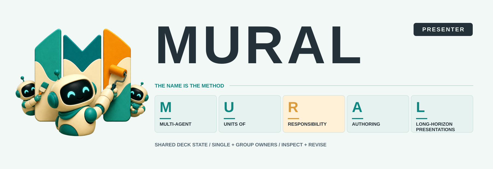

<p align="center">
  <picture>
    <source media="(prefers-color-scheme: dark)" srcset="assets/logo/exports/mural-paper-lockup-dark.svg">
    
  </picture>
</p>

<h1 align="center">MuralPresenter</h1>
<p align="center"><strong>Multi-Agent Units of Responsibility for<br>Authoring Long-Horizon Presentations</strong></p>

<p align="center">
  <a href="README_zh-CN.md">简体中文</a> ·
  <a href="#quick-start">Quick start</a> ·
  <a href="webui/README_EN.md">WebUI</a> ·
  <a href="#models-and-trajectory-training">Models</a> ·
  <a href="#evaluation">Evaluation</a> ·
  <a href="#release-status">Release status</a>
</p>

**MuralPresenter turns a request and source materials into an editable HTML presentation,
with evidence grounding, visual inspection and follow-up revision.** It combines persistent
deck state with page Owners whose responsibility continues through production and editing.

This repository accompanies the paper and provides the authoring **Skill**, execution **Harness**
and **WebUI**. See [release status](#release-status) for the scope of the available artifacts.

## Overview

- **Adaptive responsibility.** Independent pages receive Single Owners; pages needing joint content or design adjustment share a Group Owner.
- **Persistent authoring.** Shared knowledge, plans and assets support local render–inspect–revise loops and deck-wide review.
- **Trajectory training and evaluation.** The paper studies 9B/27B models trained on execution segments, public presentation benchmarks and separate Final/Process evaluation with ThreadEval.

<p align="center">
  
</p>

<p align="center"><em>Shared deck state → Single / Group Owners → visual refinement → reviewed delivery.</em></p>

## Quick start

Use Python 3.12 and `uv`. Provide your own model endpoint and credentials.

```bash
git clone https://github.com/G1nkgo7/MURAL-Presenter.git
cd MURAL-Presenter
uv sync --project webui/studio --frozen
uv sync --project webui/inference --frozen
cp webui/.env.example webui/.env
bash webui/start.sh
```

Copy the example only on first setup; preserve an existing `.env`.
Open the address printed by the launcher, normally `http://127.0.0.1:8001`.
Configure the model in the UI or deployment environment. On Windows use `webui/start.ps1`.
The first launch can install Chromium. It creates ignored `configs/runtime.local.json`
without overwriting an existing configuration. Edit that file for concurrency and ordered
GPU/CPU MinerU endpoints, or select an existing file with `MURAL_RUNTIME_CONFIG`.
PDF/Office/image attachments require MinerU; text-only tasks do not require an attachment parser.
Search and image generation require separately configured providers.

**First task:** configure a model, create a case with your request and optional attachments,
follow the execution in the workspace, then inspect the deck preview and download the deliverables.
Use the [WebUI guide](webui/README.md) for data paths, Docker, `/studio` deployment and troubleshooting.

## Command-line inference

```bash
webui/inference/.venv/bin/python scripts/run_inference.py \
  --query "Create a six-slide research presentation" \
  --workspace "$PWD/artifacts/example"
```

Use `--help` for arguments or `--doctor --json artifacts/doctor.json` for diagnostics.
Use a new workspace; preserve historical workspaces and their pinned runtime.

## Method

<details>
<summary>Responsibility units and cross-page dependencies</summary>

A whole-deck Owner retains one production history that grows with the presentation and its edits.
Per-slide Owners distribute production, while cross-page decisions require coordination between
separate contexts. MuralPresenter supports both single-page and multi-page units within one deck.
Topic or style similarity alone is insufficient for grouping: the relevant question is whether
content or design choices still need to be adjusted together.

<p align="center">
  
</p>

<p align="center"><em>Cross-page dependencies motivate a responsibility assignment that combines shared deck state with bounded page ownership.</em></p>

</details>

<details>
<summary>Agent roles, tools and handoffs</summary>

| Role | Responsibility |
| --- | --- |
| **Orchestrator** | Maintains shared knowledge and the blueprint, assigns units, reviews the deck and routes revisions; can also handle light research, routine assets and unassigned pages. |
| **Research** | Retrieves and synthesizes evidence, preserving sources, factual conditions and unresolved questions. |
| **Image** | Acquires or generates assets, inspects them and provides paths, intended uses, restrictions and target pages. |
| **Slide** | Authors HTML, inspects renders and repairs assigned pages; Single and Group Owners use the same authoring capabilities. |

Tools handle retrieval, file operations, asset processing and rendering. Agents make content and
design decisions. Handoffs carry artifact paths and usage information. Confirmed assets can reach
page Owners before the entire asset batch is ready.

<p align="center">
  
</p>

</details>

<details>
<summary>Five-stage authoring and revision</summary>

The paper describes five stages, which may overlap or recur:

1. **Knowledge Grounding:** resolve factual questions and record adopted evidence, conditions and open questions.
2. **Deck Planning:** establish the narrative, page briefs, notes, design rules and visual requests.
3. **Asset Preparation:** acquire or create visuals, inspect them and record their intended use.
4. **Parallel Authoring:** produce independent units as their shared inputs become ready, while preparation continues elsewhere.
5. **Iterative Refinement:** render, inspect and repair pages; review the assembled deck and route findings to the responsible Owners.

Content edits resume the relevant Owners. Structural edits can change units and ownership scopes.
Shared-style edits update the common state before affected pages are revised. Updated pages are
rendered and inspected again. Delivery assembles checked pages, assets and notes in deck order,
checks file completeness and exports the requested formats.

</details>

<details>
<summary>Editable HTML and export formats</summary>

MURAL uses HTML/CSS/SVG as its authoring source so that text, layout, graphics, media, and
interactions remain separately addressable. Browser rendering provides the pixel-level ground
truth for inspection, while the structured source supports targeted revision. PPTX, PDF, and
images are delivery adapters; export fidelity is evaluated rather than assumed.

</details>

## Models and trajectory training

The paper trains **MuralPresenter-9B** and **MuralPresenter-27B** on **9,000 quality-filtered
execution segments from 686 native source records**. These counts describe segments and sources,
not 9,000 completed presentations. Each segment keeps its preceding history as input context.

The public-benchmark checkpoints use **Global Selective**:

| Model | Backbone | Evaluated checkpoint |
| --- | --- | --- |
| MuralPresenter-9B | Qwen-3.5-9B | 4 epochs, 128 optimizer steps |
| MuralPresenter-27B | Qwen-3.8-27B | 2 epochs, 64 optimizer steps |

Model weights are not bundled with this source release.

<details>
<summary>Training recipe and supervision policies</summary>

| Supervision policy | Assistant actions receiving training loss |
| --- | --- |
| Full | Historical and current-segment actions. |
| Global Selective | Only current-segment actions, for every role. |
| Role-wise Selective | Current-segment actions for Slide; Full supervision for the other roles. |

Training uses MS-SWIFT, Megatron and BF16 with frozen vision encoders and mergers, a maximum
sequence length of 131,072 tokens and batch size 64. The supervision-policy comparison uses
four-epoch 27B models, distinct from the two-epoch 27B public-benchmark checkpoint.
These are paper experiment settings, not WebUI generation defaults. Model weights are not
bundled with this source release.

</details>

## Evaluation

| Evaluation | Coverage in the manuscript | What it measures |
| --- | --- | --- |
| PresentBench | 238 tasks | Delivered presentation quality under task-specific rubrics. |
| SlidesGen-Bench | 189 tasks | Content accuracy and computational aesthetics. |
| DECKBench | 294 tasks, five editing turns each | Response to multi-turn editing through benchmark-defined similarity changes. |
| ThreadEval | 35 Chinese/English requests across six domains, requiring 20–40 pages | Long-deck final quality and separate process evidence. |

**ThreadEval** separates two tracks. **Final = 70% Deck + 30% Page**; Knowledge is part of Deck.
**Process** independently evaluates research support and adoption (**R**), executable planning
(**P**), asset preparation and actual-use handoffs (**I**), and plan realization, render inspection
and slide–speech alignment (**S**). Process is not included in Final. Missing compatible action
records do not by themselves establish that an action was omitted.

<details>
<summary>Experiment protocols and interpretation</summary>

Interpret the experiments under their recorded protocols:

- Ten PresentBench tasks and ten ThreadEval tasks informed checkpoint selection and remain in the respective reported means.
- The 27B PresentBench result includes score-conditioned regeneration and output selection; it does not estimate a fine-tuning gain under an equal generation budget.
- DECKBench imports preceding artifacts into a fresh workspace each turn, evaluating artifact continuity rather than persistent Owner history.
- Adaptive and per-slide ownership achieve similar mean Final scores; both use more recorded production work than whole-deck ownership. The study does not establish elapsed-time speedup.
- Search availability, image services and quotas differ across the supervision-study runs, limiting causal attribution to the training policy.

</details>

## Release status

| Artifact | Availability |
| --- | --- |
| Authoring Skill and Harness | Included: frozen 0919 source pair, verified against its original inventory. |
| WebUI and launchers | Included: portable configuration, CLI and `/studio` deployment support. |
| Public logos and method figures | Included; [figure provenance](assets/figures/README.md) records current and historical versions. |
| 9B / 27B model weights | Not included; no public checkpoint download is linked yet. |
| Training data, ThreadEval cases and evaluation pipelines | Not included in this runtime release. |
| Paper link and citation metadata | Awaiting final author-supplied publication metadata. |

The runtime source pin and trained model checkpoints are separate version identities.
The 0919 source pin does not establish that every later paper experiment used an identical
runtime and configuration.

<details>
<summary>What is needed to reproduce paper scores?</summary>

Score reproduction additionally requires exact inputs and checksums, weights and chat templates,
evaluation adapters, font shims, Judge settings and output-selection/coverage records.
The original evaluation font inventory was larger than this repository's font bundle.
Running the application or passing source checks does not reproduce the paper's scores.

</details>

## Repository layout

```text
MURAL-Presenter/
├── README.md / README_zh-CN.md
├── skills/mural-presenter-v1/       # Frozen authoring Skill and tools
├── harnesses/mural-presenter-v1/    # Frozen inference and delivery runtime
├── webui/                          # UI, server, dependency locks and launchers
├── assets/                         # Public logos, icons and method diagrams
├── configs/                        # Runtime template, MinerU and release provenance
├── fonts/                          # Bundled rendering fonts
├── scripts/                        # Portable CLI and configuration adapters
├── tools/                          # Source verification and integration freezing
├── tests/                          # Public integration regression tests
└── .github/                        # CI and contribution templates
```

The core directory names and internal assets, references, docs and tests are part of its frozen
identity. Keep them intact. Public logos and diagrams live in `assets/logo/exports/` and
`assets/figures/`; [figure provenance](assets/figures/README.md) records the current manuscript exports.
Design drafts remain local. Root-level `benchmark/`, `docs/`, `examples/`,
`paper/`, training material and the independent `site/` are not included in this release.
Deployment credentials, environments, databases and generated cases remain local and ignored.
Necessary usage, provenance and validation information is consolidated in these READMEs.

## Versioning and validation

The 254 core files retain the 0919 source snapshot
`mural-presentbench-qwen35-9b-20260919T163556Z`. Deployment paths are resolved at launch;
portable integration updates are recorded separately in `configs/releases/mural-paper-v1.json`.

```bash
python tools/check_paper_release.py
```

See [Contributing](CONTRIBUTING.md) for the source and manifest workflow, and
[packaging CI](.github/workflows/public-surface.yml) for the tested scope.

<details>
<summary>Source inventory and hash verification</summary>

The active manifest is `configs/releases/mural-paper-v1.json`.
`configs/releases/upstream-0919/` retains the original 319-file publication inventory,
its pin and its release hashes. Historical inventory entries record provenance; they do not
require publishing the original internal pipeline configurations or benchmark scripts.

All 55 Skill and 199 Harness files retain the original combined SHA-256:
`378c3ac7fa26d06b91f5408c7a25e7350b9b37e712611a322e387ae13a2d64e3`.
Historical examples and links inside that frozen source may refer to the original environment;
use this README's portable launch instructions. Two unreadable upstream WebUI tests were not
imported. The portable integration has a separate release identity and digest.

```bash
python tools/check_paper_release.py
```

This verifies the frozen core, active integration and tracked release boundaries.
Do not refresh core hashes to conceal source changes. Integration updates require their own
review, tests and manifest; see [Contributing](CONTRIBUTING.md).

</details>

<details>
<summary>Validation record and known limits</summary>

CI commands are in [.github/workflows/public-surface.yml](.github/workflows/public-surface.yml).
They cover portable configuration, HTTP and `/studio` routing, release/configuration contracts,
and active WebUI configuration. Use isolated test data, not an existing Studio database.

The compact public tree was checked on Linux on 2026-10-10: 10 portable/source-digest tests,
95 release/configuration tests and 139 WebUI tests passed; one browser test was skipped.
The example launcher preflight passed. These checks used an isolated Git worktree and existing
locked-dependency test environments, without model requests or production data.

The complete historical suite has not passed. The frozen source retains these known failures:

- `test_agent_runtime.py::test_resume_preserves_inspect_feedback_as_tool_context_without_reconciliation`:
  resumed tool content is a string where the assertion expects text/image parts.
- `test_creation_config_runtime.py::test_presentation_change_requires_new_render_and_real_visual_consumption`:
  the second inspection returns `inspection_limit_reached` after a language change.

Two historical tests cannot collect without unpublished canary modules
(`test_real_webui_canary.py`, `test_refero_font_audit.py`); some legacy WebUI tests require archived
runtimes. Packaging CI deliberately selects its documented scope. Docker builds, Windows/macOS
startup and the complete 238-case experiment have not been validated by these packaging checks.
Local deployment smoke tests are not paper-score reproduction.

</details>

## License and citation

Project-wide licensing awaits confirmation by the rights holders. Third-party terms remain
applicable; see [third-party notices](webui/THIRD_PARTY_NOTICES.md) and [font records](fonts/FONTS.md).
Final authors, paper URL/DOI, citation metadata and the immutable paper tag remain to be confirmed.
