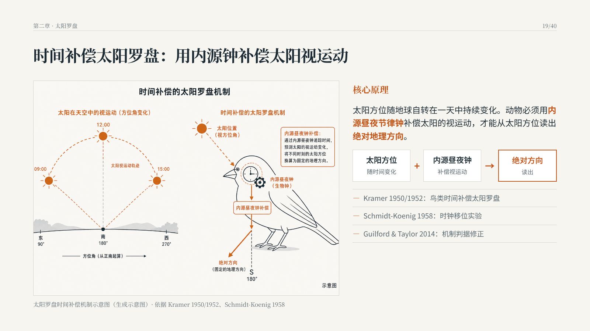
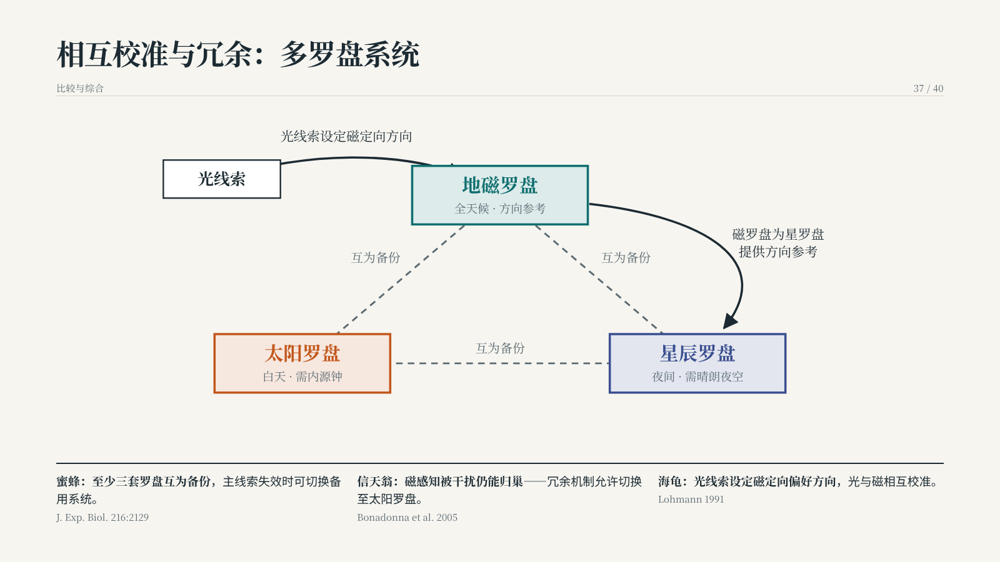
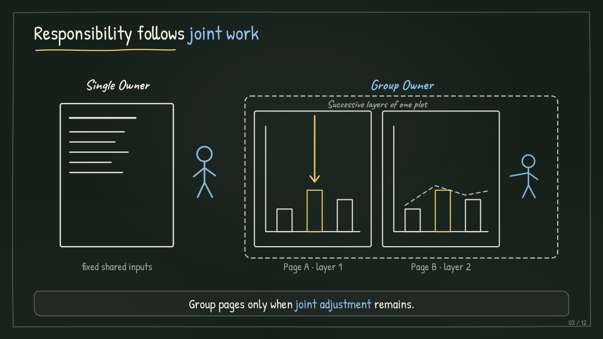
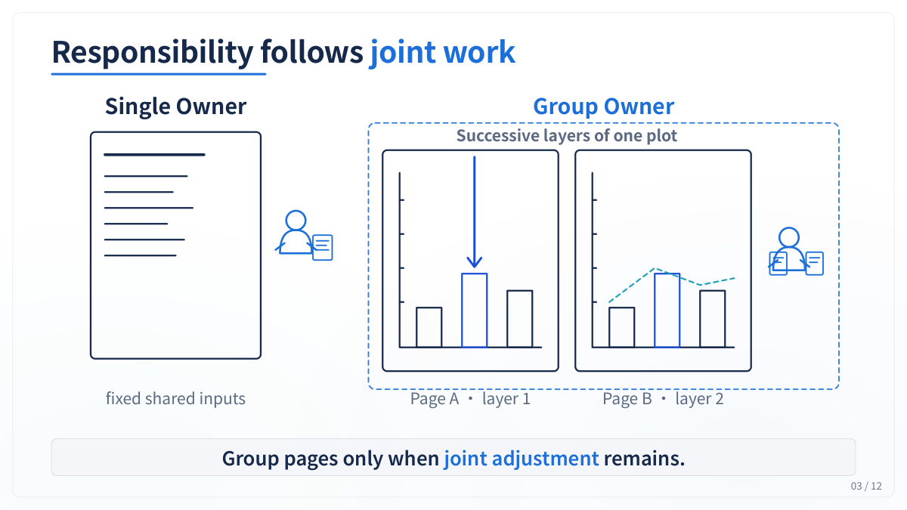
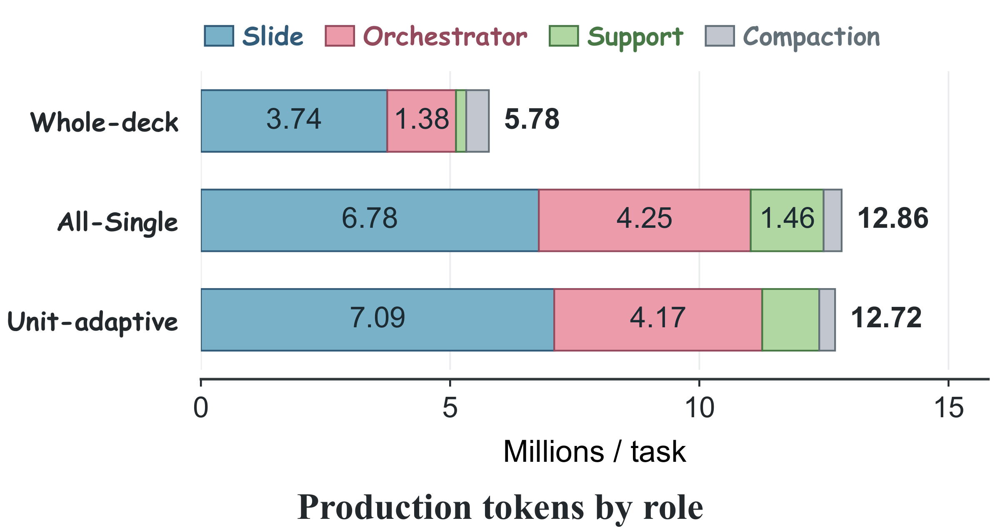
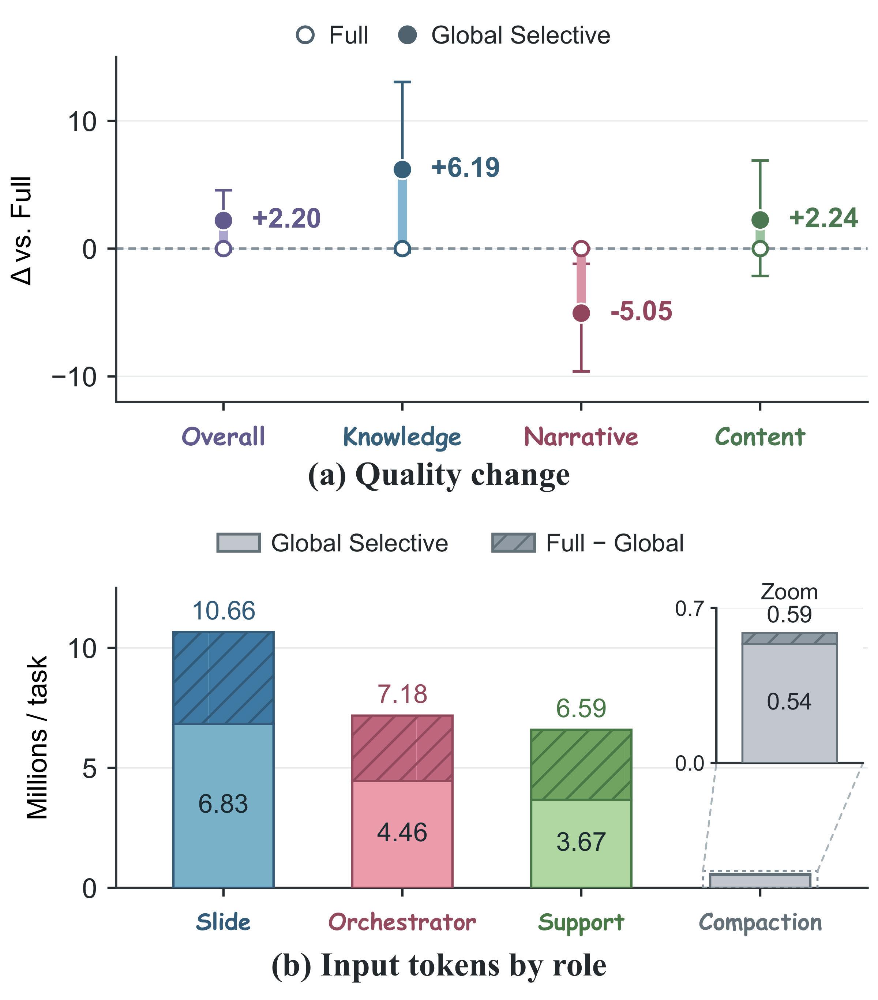
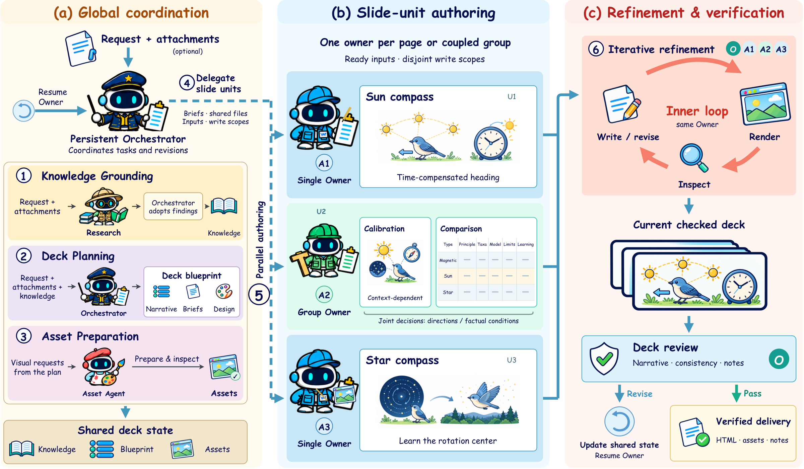
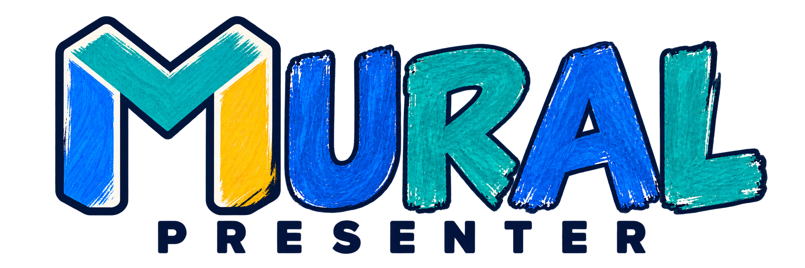

<a name="项目概览"></a>
<p align="center">
  <picture>
    <source media="(prefers-color-scheme: dark)" srcset="assets/logo/exports/street-v2/mural-banner-dark.png">
    
  </picture>
</p>

<h1 align="center"> MuralPresenter</h1>
<p align="center"><strong>Multi-Agent Units of Responsibility for Authoring Long-Horizon Presentations</strong></p>
<p align="center">从需求和资料出发，生成可预览、可修改的演示文稿</p>

<p align="center">
  <a href="https://github.com/G1nkgo7/MURAL-Presenter#readme-en">English</a> · <strong>简体中文</strong>
</p>
<p align="center">
  <a href="#生成与修改示例">🖼️ 效果示例</a> ·
  <a href="#安装与启动">🚀 快速开始</a> ·
  <a href="webui/README.md"> WebUI</a>
</p>

## News · 最新动态

论文与版本动态将在这里更新。

## 生成与修改示例

> **需求摘要：** 为生命科学高年级本科生制作 40 页教学演示，讲解地磁、太阳与星辰罗盘，
> 包含科学示意图、真实照片和对比表。

**实际输出 · MuralPresenter-27B（Global Selective，2 epoch／checkpoint-64）。**
下方是同一次已完成的 40 页中文演示中的第 19、37 页，点击图片可查看原始渲染。

<table>
  <tr><th width="50%">第 19 页 · 太阳罗盘机制</th><th width="50%">第 37 页 · 相互校准与冗余</th></tr>
  <tr>
    <td><a href="assets/figures/animal-compass/slide-19.png"></a></td>
    <td><a href="assets/figures/animal-compass/slide-37.png"></a></td>
  </tr>
</table>

[查看三张代表页及来源，含三种罗盘对比表](assets/figures/animal-compass/README.md) ·
直接采用归档批次的 1600 × 900 原始渲染，未进行图片修饰。

<details>
<summary>另一个例子：修改已有演示文稿</summary>

**同一份演示文稿，由原有 Owner 继续修改。** 论文中的定性案例先将介绍本论文的演示文稿从
10 页扩展到 12 页，再从黑板风格改为浅蓝白色，并调整解释性图示。下方展示第 3 页的前后对照，完整画廊保留六组。

<table>
  <tr><th width="50%">修改前 · 黑板风格</th><th width="50%">修改后 · 浅蓝白色</th></tr>
  <tr>
    <td><a href="assets/figures/revision-case/before-03.png"></a></td>
    <td><a href="assets/figures/revision-case/after-03.png"></a></td>
  </tr>
</table>

[查看全部六组前后对照](assets/figures/revision-case/README.md) · [配图来源](assets/figures/README.md)。
这些图片直接导出自论文附录，不是在线 WebUI 演示；该定性案例不计入 benchmark 均值。

</details>

## 安装与启动

需要 Python 3.12、uv，以及自己的模型服务和凭据。

```bash
git clone https://github.com/G1nkgo7/MURAL-Presenter.git
cd MURAL-Presenter
uv sync --project webui/studio --frozen
uv sync --project webui/inference --frozen
test -f webui/.env || cp webui/.env.example webui/.env
bash webui/start.sh
```

打开启动器打印的地址，默认 `http://127.0.0.1:8001`。
填写 API 地址、模型名和 API key，添加一个多模态模型。

<details>
<summary>配置、附件解析与可选服务</summary>

仅首次部署复制示例配置；已有 `.env` 应保留。Windows 使用 `webui/start.ps1`。
首次启动可能下载 Chromium。启动器生成被忽略的 `configs/runtime.local.json`，不会覆盖已有配置。
在其中设置并发及按顺序排列的 MinerU GPU/CPU 服务地址，或用 `MURAL_RUNTIME_CONFIG` 指定已有文件。
PDF、Office、图片附件解析需要 MinerU；纯文本任务不需要附件解析服务。搜索和生图服务分别配置。

</details>

**先试一个短任务。** 创建 case，输入：

> 制作一份六页教学演示，介绍动物如何使用地磁、太阳和星辰罗盘，包含解释性图示与一张对比表。

**再继续修改。** 生成完成后，在同一 case 中发送：

> 减少文字，统一示意图与对比表中的方向约定，保持六页。

完成后预览并下载结果。部署、数据路径与排错见 [WebUI 使用说明](webui/README.md)。

<a name="命令行推理"></a>

<details>
<summary>命令行推理</summary>

```bash
webui/inference/.venv/bin/python scripts/run_inference.py \
  --query "制作一份六页的研究介绍演示" \
  --workspace "$PWD/artifacts/example"
```

使用 `--help` 查看参数，或用 `--doctor --json artifacts/doctor.json` 生成诊断报告。
新任务使用新工作区；保留历史工作区及其固定的运行版本。

</details>

## Research · 论文研究

<a name="实验结果速览"></a>

下表摘自当前论文的公共 benchmark 结果，并非本次更新重新运行所得。四行均使用 MuralPresenter 创作框架。

| 基座／训练后模型 | PresentBench Overall ↑ | SlidesGen 内容准确率 (%) ↑ | SlidesGen 美学总分 ↑ |
| --- | ---: | ---: | ---: |
| Qwen-3.5-9B | 41.1 | 74.71 | 14.46 |
| **MuralPresenter-9B** | **47.3** | **90.21** | **18.38** |
| Qwen-3.8-27B | 69.4 | 93.33 | 18.58 |
| **MuralPresenter-27B** | **72.6** | **94.92** | **19.12** |

PresentBench 覆盖 238 个任务，SlidesGen-Bench 覆盖 189 个任务，各项指标的量纲不同。
理解结果时需结合 checkpoint 选择与生成条件，详见[评测协议](#评测)。

<details>
<summary><strong>分析配图 · 责任分配工作量与选择性监督</strong></summary>

**责任分配工作量。** 35 个匹配任务中，每个任务制作阶段记录到的输入与输出 token 均值，不含共享准备阶段。
统计值是下界，不能据此推断实际耗时加速。

<p align="center">
  <a href="assets/figures/responsibility-workload.png"></a>
</p>

**选择性监督。** Global 相对 Full 的质量变化及配对 95% bootstrap 区间，以及各角色输入 token。
这些探索性结果来自工具条件存在差异的运行，不能单独归因为训练策略。

<p align="center">
  <a href="assets/figures/supervision-ablation.png"></a>
</p>

</details>

<a name="方法详解"></a>

<details>
<summary>工作原理：共享资料与持续负责的页面 Owner</summary>

Orchestrator 负责维护共享事实、页面计划和素材。**Owner 就是持续负责某些页面的 Agent**，
承担制作、检查和修改：能独立完成的页面交给 Single Owner，需要共同决策的页面交给 Group Owner。
后续修改仍交给相应 Owner，修改后再次检查页面与整册效果。

<p align="center">
  <a href="assets/figures/ownership-workflow.png"></a>
</p>

动物罗盘流程图用于讲解方法，不代表归档案例的具体分组或修改记录。另见[跨页依赖图](assets/figures/cross-page-dependencies.png)与[角色分工图](assets/figures/roles-and-tools.png)。
HTML/CSS/SVG 是可编辑的创作源文件，PPTX、PDF 和图片是交付格式。

</details>

<a name="模型与轨迹训练"></a>

<details>
<summary>模型与训练细节</summary>

论文基于 **686 条原生源记录中的 9,000 个质量筛选后执行片段**，训练
**MuralPresenter-9B** 与 **MuralPresenter-27B**。这些数字表示片段和源记录数量，
并不表示生成了 9,000 份完整演示文稿。每个片段保留此前历史作为输入上下文。

公开 benchmark 主实验使用 **Global Selective** checkpoint：

| 模型 | 基座 | 评测 checkpoint |
| --- | --- | --- |
| MuralPresenter-9B | Qwen-3.5-9B | 4 epochs，128 个优化步 |
| MuralPresenter-27B | Qwen-3.8-27B | 2 epochs，64 个优化步 |

本次源码发布不附带模型权重。

**训练设置与监督策略**

| 监督策略 | 参与训练损失计算的 Assistant 动作 |
| --- | --- |
| Full | 历史动作和当前片段动作。 |
| Global Selective | 所有角色都只监督当前片段动作。 |
| Role-wise Selective | Slide 只监督当前片段动作，其他角色采用 Full。 |

训练使用 MS-SWIFT、Megatron 和 BF16，冻结视觉编码器与 merger，最大序列长度为 131,072 tokens，
batch size 为 64。监督策略对比使用训练 4 轮的 27B 模型，与主实验的 2 轮 27B checkpoint 不同。
以上是论文实验设置，不是 WebUI 的生成默认值。本次源码发布不附带模型权重。

</details>

<a name="评测"></a>

<details>
<summary>评测覆盖范围、指标与结论适用范围</summary>

| 评测 | 当前论文覆盖范围 | 评测内容 |
| --- | --- | --- |
| PresentBench | 238 个任务 | 按任务专属 rubric 评估交付演示文稿的质量。 |
| SlidesGen-Bench | 189 个任务 | 内容准确率与计算美学。 |
| DECKBench | 294 个任务，每个任务修改 5 轮 | 使用 benchmark 定义的相似度变化衡量多轮编辑结果。 |
| 内部长演示任务 | 6 个领域的 35 个中英文请求，每个要求 20–40 页 | 分别评估长演示文稿的最终质量与过程证据。 |

内部评测分别报告质量与过程。**Overall = 70% Deck + 30% Page**，Knowledge 属于 Deck。
**Process** 独立评估研究支持与采纳（**R**）、可执行规划（**P**）、素材准备与实际使用交接（**I**），
以及计划落地、渲染检查和讲稿与页面对应（**S**）。Process 不计入 Overall。当前过程分析排除了
依赖创作轨迹的评分条目，包含正式和诊断记录；缺少兼容动作记录，本身不能证明 Agent 没有执行对应动作。

**实验协议与结论适用范围**

实验结论应结合论文记录的协议理解：

- PresentBench 的 10 个任务及内部长演示任务中的 10 个任务参与了 checkpoint 选择，并保留在各自报告均值中；完整选择历史尚未重建。
- DECKBench 每轮把上一轮产物导入新工作区，测试产物延续性，没有测试 Owner 历史的持续保留。
- 自适应与逐页分配的 Overall 均值接近，二者记录到的制作工作量都高于整册单 Owner；实验未建立耗时加速结论。
- 监督策略实验中的搜索可用性、生图服务和配额存在差异，限制了将结果变化单独归因于训练策略。

</details>

## 品牌素材

独立标识、头像与画家吉祥物沿用顶部横幅的壁画风格。点击图片可打开原始 PNG。

<table>
  <tr><th width="33%">主标识 · 透明背景</th><th width="33%">头像 · 彩色圆形徽章</th><th width="33%">画家吉祥物 · 透明背景</th></tr>
  <tr><td align="center"><a href="assets/logo/exports/street-v2/mural-mark.png"></a></td><td align="center"><a href="assets/logo/exports/street-v2/mural-avatar-circle.png"></a></td><td align="center"><a href="assets/logo/exports/street-v2/mural-mascot.png"></a></td></tr>
</table>

<details>
<summary>字标与论文分享图</summary>

<p align="center">
  <picture>
    <source media="(prefers-color-scheme: dark)" srcset="assets/logo/exports/street-v2/mural-wordmark-dark.png">
    
  </picture>
</p>

字标随阅读器深浅色主题切换。

<p align="center">
  <a href="assets/logo/exports/street-v2/mural-social-card.png"></a>
</p>

[浅色字标](assets/logo/exports/street-v2/mural-wordmark-light.png) · [深色字标](assets/logo/exports/street-v2/mural-wordmark-dark.png) · [论文分享图](assets/logo/exports/street-v2/mural-social-card.png)

</details>

完整素材、使用说明与版本记录见[品牌指南](assets/logo/exports/street-v2/README.md)。

## 发布状态

**已提供：** 0919 冻结版 Skill/Harness、WebUI、启动器与正式配图。训练数据、内部评测流水线和模型权重暂未附带。
论文链接及最终公开信息待补充。

<details>
<summary>源码版本与论文分数复现</summary>

运行时源码 pin 与训练模型 checkpoint 分别维护。0919 源码 pin 不能证明后续每组论文实验
都使用完全相同的运行时与配置。

复现分数还需要精确输入及校验信息、权重和对话模板、评测适配器、字体补丁、Judge 配置，
以及结果选择与覆盖记录。原评测字体库大于本仓库附带字体库。
程序运行成功或源码校验通过，不等于论文分数已复现。

</details>

<a name="公开目录"></a>
<a name="版本维护与验证"></a>

目录结构、源码校验与已知限制：[贡献说明](CONTRIBUTING.md#公开目录) · [CI](.github/workflows/public-surface.yml)。

<a name="许可与引用"></a>

## Citation · 引用

以下为尚未投稿稿件的临时引用，作者及正式发表信息后续更新。

```bibtex
@misc{muralpresenter2026,
  title  = {MuralPresenter: Multi-Agent Units of Responsibility for Authoring Long-Horizon Presentations},
  author = {Anonymous Authors},
  year   = {2026}
}
```

机器可读引用信息：[CITATION.cff](CITATION.cff)。

## License · 许可

项目许可证待确认；现有[第三方条款](webui/THIRD_PARTY_NOTICES.md)与[字体许可](fonts/FONTS.md)继续适用。
