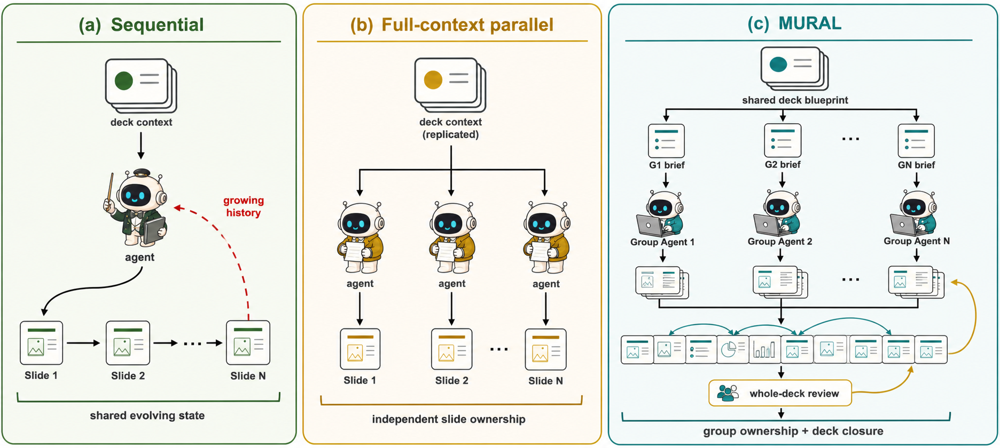
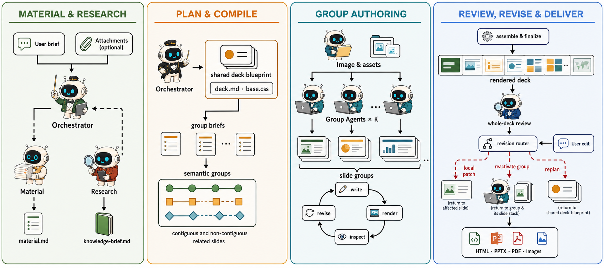

<p align="center">
  <picture>
    <source media="(prefers-color-scheme: dark)" srcset="assets/logo/exports/mural-logo-lockup-dark.png">
    
  </picture>
</p>

<p align="center"><strong>面向可编辑长程演示文稿的完整生命周期创作框架。</strong></p>

# MURAL Presenter

**Multi-Agent Unified Revision-Aware Authoring for Long-Horizon Presentations** 的论文实现。

本仓库发布 0919 创作 Skill、配套 Harness 和 WebUI。254 个核心源码文件保持
`mural-presentbench-qwen35-9b-20260919T163556Z` 实验快照的原始字节，部署路径由启动层解析。

[English](README.md) · [安装与启动](#安装与启动) · [WebUI 使用说明](webui/README.md) · [实验范围](#实验范围) · [贡献说明](CONTRIBUTING.md)

## 名字就是方法

| 字母 | 对应含义 | 在方法中的落点 |
| :---: | --- | --- |
| **M** | **Multi-Agent** | 专业角色可以并行，但不会把每一页都变成彼此孤立的任务。 |
| **U** | **Unified** | 一份 shared deck blueprint 持续承载受众、证据、术语、叙事与设计决策。 |
| **R** | **Revision-Aware** | 后续修改按真实影响范围，从单页、页面组或整册规划处继续。 |
| **A** | **Authoring** | 真正可复用的是一条可执行生命周期，而不是一次性出图 prompt。 |
| **L** | **Long-Horizon Presentations** | 决策需要跨阶段、远距页面与后续修改轮次持续有效。 |

> **MURAL 不只是把一条长工作流拆成子任务，而是让 Agent 的责任边界匹配整册依赖结构，
> 并在并行制作后重新恢复整册闭合。**

## 一眼看懂 MURAL

**MURAL-Presenter**（下文简称 MURAL）是一个面向可编辑 HTML 演示文稿完整生命周期的技能驱动多智能体框架。
它不把演示文稿创作视为一次性出图，而是一个持续的 authoring 过程：理解需求，整理材料与事实，
规划整册，准备素材，联合制作关联页面，检查渲染像素，复审整册，响应后续修改，并导出最终产物。

这里的 **long horizon** 指一项决策需要跨越阶段、页面和修改轮次持续有效的距离。
例如，开场确定的受众假设会影响整册表达；第 3 页给出的定义可能在第 18 页再次使用；
后续修改还需要更新真正受影响的页面，同时尽量保持其他页面不变。

- **共享状态、按责投影。** 全局决策只建立一次，再编译成 group/page briefs；下游不必从持续增长的对话中重建整场演讲。
- **页面组责任制。** 具有叙事或视觉依赖的页面由同一 Group Agent 负责，并共同完成 render–inspect–revise 循环，即使页面并不连续。
- **修改感知续作。** 后续请求沿用同一生命周期，只重新执行能够可靠保持整册决策的最小范围。

## 缺失的中间层：整册 → 页面组 → 单页

单 Agent 在一个连续上下文中完成整册，但其执行历史会随页数和后续修改不断增长。
逐页并行能够缩短单条轨迹，却把跨页关系转化为多个独立上下文之间的状态传递问题。
这首先是责任划分问题，而不只是调度问题。
MURAL 在整册和单页之间增加了一个执行与责任单元：**页面组（slide group）**。

具有共同叙事职责、设计系统、素材系列或显式依赖的页面，由同一个 Group Agent 联合生成和检查；
不同页面组仍可并行。组间汇合后，whole-deck Review 再恢复整册视角。

<p align="center">
  
</p>

<p align="center"><em>图 1：MURAL 将具有依赖关系的页面交给同一个 Group Agent，并在并行创作后通过整册复审恢复全局闭合。</em></p>

## 完整生命周期

MURAL 通过可复用的 **MURAL Authoring Skill** 串联四个阶段：

1. **Material and research**：整理可选附件，并补齐会改变结论的事实缺口。
2. **Plan and compile**：建立 shared deck blueprint、整册设计系统、页面地图与完整页面组。
3. **Group authoring**：先由统一 Image 阶段收口全册素材，再由多个 Group Agent 联合制作关联页面。
4. **Review, revise, and deliver**：装配与整册复审，按影响范围处理后续修改，并导出多种格式。

<p align="center">
  
</p>

<p align="center"><em>图 2：MURAL Authoring Skill 串联材料与研究、整册规划、分组创作、整册复审、按影响范围修改和多格式交付。</em></p>

修改路由会选择能够可靠完成任务的最小范围：

- **Page patch**：精确定位到单页和元素的局部修改。
- **Group replay**：涉及一组关联页面或组内共同视觉语言的修改。
- **Deck replan**：只有当请求改变整册决策或结构时，才重新规划。

## 安装与启动

需要 Python 3.12、uv，以及自己的模型服务和凭据。

```bash
uv sync --project webui/studio --frozen
uv sync --project webui/inference --frozen
cp webui/.env.example webui/.env
bash webui/start.sh
```

仅首次部署复制示例配置；已有 `.env` 应保留。打开启动器打印的地址，默认
`http://127.0.0.1:8001`。模型可在 WebUI 或部署环境中配置；Windows 使用 `webui/start.ps1`。
首次启动可能下载 Chromium。启动器生成被忽略的 `configs/runtime.local.json`，不会覆盖已有配置。
在其中设置并发及按顺序排列的 MinerU GPU/CPU 服务地址，或用 `MURAL_RUNTIME_CONFIG` 指定已有文件。
PDF、Office、图片附件解析需要 MinerU；纯文本任务不需要附件解析服务。搜索和生图服务分别配置。

## 命令行推理

```bash
webui/inference/.venv/bin/python scripts/run_inference.py \
  --query "制作一份六页的研究介绍演示" \
  --workspace "$PWD/artifacts/example"
```

使用 `--help` 查看参数，或用 `--doctor --json artifacts/doctor.json` 生成诊断报告。
新任务使用新工作区；保留历史工作区及其固定的运行版本。

## 为什么使用 HTML？

MURAL 以 HTML/CSS/SVG 作为创作源，使文字、布局、图形、媒体与交互保持独立可寻址。
浏览器渲染提供像素级检查依据，结构化源码则支持定向修改。PPTX、PDF 和图片是交付适配层，
不同格式的导出保真度需要实际评估，而不是默认等价。

## 公开目录

```text
MURAL-Presenter/
├── README.md / README_zh-CN.md
├── skills/mural-presenter-v1/       # 冻结的创作 Skill 与工具
├── harnesses/mural-presenter-v1/    # 冻结的推理与交付运行时
├── webui/                          # 前端、服务端、依赖锁和启动器
├── assets/                         # 正式 logo、图标与方法配图
├── configs/                        # 运行配置模板、MinerU、版本来源清单
├── fonts/                          # 渲染所需字体
├── scripts/                        # 便携命令行入口和配置适配
├── tools/                          # 源码校验和集成版本冻结
├── tests/                          # 公开集成回归测试
└── .github/                        # 持续集成与贡献模板
```

Skill/Harness 的目录名及其内部 assets、references、docs、tests 都属于冻结版本，保持完整。
正式品牌素材位于 `assets/logo/exports/`，方法配图位于 `assets/figures/`，设计草稿保留本地。
根目录 `benchmark/`、`docs/`、`examples/`、`paper/`、训练材料和独立
`site/` 不纳入本次发布。密钥、环境、数据库和生成 case 也不上传。必要说明已合并到 README。
本机保留这些目录不代表它们会进入 Git 提交。

## 版本来源与校验

当前发布清单为 `configs/releases/mural-paper-v1.json`。
`configs/releases/upstream-0919/` 保留原始 319 文件发布清单、版本 pin 和各项哈希。
历史清单只证明来源，其中记录的内部数据流程配置及评测脚本不作为本次发布依赖。

55 个 Skill 文件和 199 个 Harness 文件的原始联合 SHA-256 为：
`378c3ac7fa26d06b91f5408c7a25e7350b9b37e712611a322e387ae13a2d64e3`。
冻结源码中的历史示例或链接可能指向原始环境，实际使用以本 README 的便携入口为准。
两个无法读取的上游 WebUI 测试未导入。便携集成单独维护版本身份和摘要。

```bash
python tools/check_paper_release.py
```

该命令检查冻结核心、当前集成及 Git 发布边界。不得为绕过检查而刷新核心哈希。
集成层改动需单独审查、验证并更新清单，流程见贡献说明。

## 实验范围

本次发布范围是运行系统源码，不包含完整实验制品。
参考 0919 实验使用 Qwen3.5-9B，开启 thinking，关闭 Critic、搜索和生图，运行 238 个
PresentBench 案例，每个案例最多生成 3 次。这不是所有 WebUI 模型的默认配置。

复现论文分数还需要精确输入及校验信息、模型权重和对话模板、评测适配器、字体补丁、Judge
配置及结果覆盖统计。本包不提供完整 benchmark、训练流水线、模型权重和论文结果表。
原评测字体库大于本仓库附带字体库。程序运行成功或源码校验通过，不等于论文分数已复现。

## 验证与已知限制

自动检查命令见 [.github/workflows/public-surface.yml](.github/workflows/public-surface.yml)，
覆盖便携配置、HTTP 和 `/studio` 路由、版本/配置合约及当前 WebUI 配置。测试应使用独立数据目录。

2026-10-10 在 Linux 上验证精简公开文件树：便携入口及源码摘要测试 10 项、版本/配置测试 95 项、
WebUI 测试 139 项通过，1 项浏览器测试跳过；示例启动预检通过。验证使用独立 Git 工作树和已有的
锁定依赖测试环境，不调用模型，不访问生产数据。

完整历史测试套件尚未全部通过。冻结源码保留了以下已知失败：

- `test_agent_runtime.py::test_resume_preserves_inspect_feedback_as_tool_context_without_reconciliation`：
  续跑工具内容为字符串，测试期望文本/图片内容块。
- `test_creation_config_runtime.py::test_presentation_change_requires_new_render_and_real_visual_consumption`：
  更改演示语言后，第二次检查返回 `inspection_limit_reached`。

`test_real_webui_canary.py`、`test_refero_font_audit.py` 缺少未发布的 canary 模块；部分历史
WebUI 测试依赖归档运行时。因此 CI 显式选择公开范围，并不代表完整历史套件通过。
Docker 构建、Windows/macOS 启动和完整 238 案例实验未由这些打包检查验证。
本机真实生成冒烟测试也不能替代论文实验复现。

## 许可与引用

项目整体许可证等待权利人确认。第三方原有条款继续适用，参见
[第三方声明](webui/THIRD_PARTY_NOTICES.md)及[字体记录](fonts/FONTS.md)。
最终作者、论文 URL/DOI、引用信息和固定论文 tag 待确认，不填写虚构元数据。
