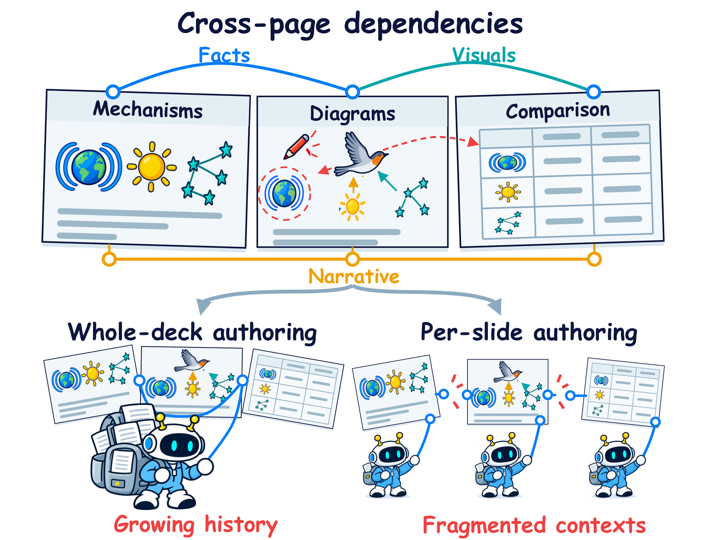
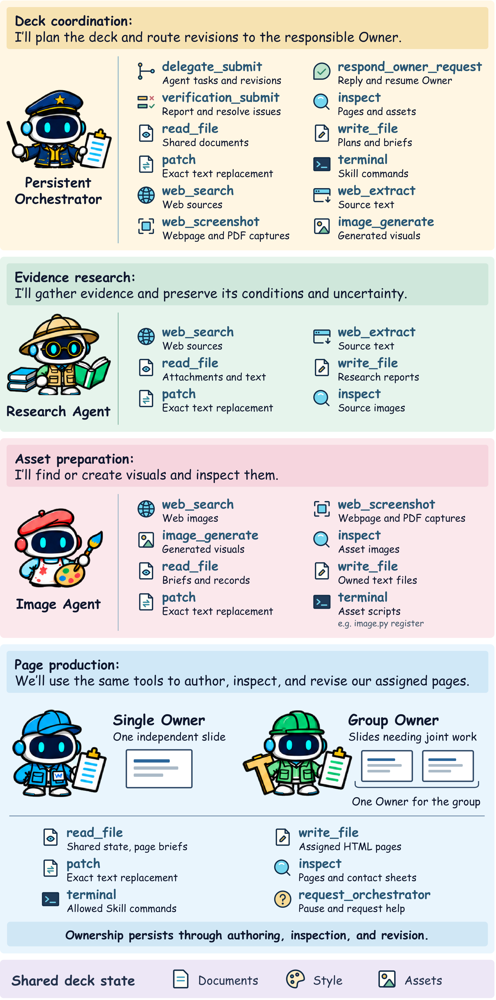

<p align="center">
  
</p>

<h1 align="center">MuralPresenter</h1>
<p align="center"><strong>Multi-Agent Units of Responsibility for<br>Authoring Long-Horizon Presentations</strong></p>
<p align="center">持续维护整册状态 · 自适应页面责任分配 · 可编辑 HTML 演示文稿</p>

本仓库配套论文 **MuralPresenter: Multi-Agent Units of Responsibility for Authoring Long-Horizon
Presentations**，发布创作 Skill、配套 Harness 和 WebUI。下文的方法、训练与评测介绍依据当前论文稿件。

发布的运行时保留 0919 源码快照：254 个核心文件与
`mural-presentbench-qwen35-9b-20260919T163556Z` 字节一致。
这一源码版本与论文评测的 9B/27B 训练 checkpoint 分别记录，部署路径由启动层解析。

[English](README.md) · [安装与启动](#安装与启动) · [WebUI 使用说明](webui/README.md) · [模型与训练](#模型与轨迹训练) · [评测与发布范围](#评测与发布范围) · [贡献说明](CONTRIBUTING.md)

## 一眼看懂 MuralPresenter

MuralPresenter 是面向可编辑 HTML 演示文稿的技能驱动多智能体框架，覆盖证据整理、整册规划、
素材准备、页面制作、渲染检查、后续修改与导出。**Long horizon** 指决策需要跨阶段、远距页面和
后续修改轮次持续有效。

核心方法是**自适应责任单元分配（unit-adaptive responsibility）**：按页面是否需要共同调整来
分配制作责任，并在创作、检查和修改中持续保留这一责任范围。

- **共享整册状态**：保存已采纳知识、制作蓝图、设计规则与素材记录。
- **Single Owner**：负责输入与表达方案已经确定、可以独立制作的单页。
- **Group Owner**：负责需要共同决定内容或设计的一组页面，页面可以不相邻。
- **持续协调**：将修改交回对应 Owner，并从整册视角检查不同单元之间的一致性。

## 为什么需要责任单元？

一个 Owner 制作整册时，其制作历史会随页面与修改不断增长。逐页分配 Owner 可以分散制作任务，
跨页决策则需要在独立上下文之间协调。MuralPresenter 在同一份演示文稿中同时支持单页和多页单元。
分组依据是内容或设计决策是否仍需共同调整；仅仅主题相同或风格相似，并不足以决定分组。

<p align="center">
  
</p>

<p align="center"><em>跨页依赖要求制作责任同时具备共享整册状态与明确的局部范围。</em></p>

## 角色与工具

| 角色 | 职责 |
| --- | --- |
| **Orchestrator** | 维护共享知识与蓝图，分配责任单元，复审整册并路由修改；也可处理轻量研究、常规素材与尚未分配的页面。 |
| **Research** | 检索和综合证据，保留来源、事实成立条件与未解决问题。 |
| **Image** | 获取或生成素材，进行视觉检查，交接路径、用途、限制和目标页面。 |
| **Slide** | 制作 HTML、检查渲染并修复所负责页面；Single Owner 和 Group Owner 使用同一套创作能力。 |

工具执行检索、文件操作、素材处理和渲染，Agent 决定内容与设计。任务通过文件路径和使用说明交接。
已经确认可用的素材可以先交给页面 Owner，无需等待全批次素材完成。

<details>
<summary>展开查看论文中的角色与工具图</summary>

<p align="center">
  
</p>

</details>

## 创作与修改流程

论文将创作分为五个可重叠、可重复进入的阶段：

1. **Knowledge Grounding（知识奠基）**：解决事实问题，记录采纳的证据、成立条件与开放问题。
2. **Deck Planning（整册规划）**：确定叙事、页面 brief、讲稿、设计规则与视觉需求。
3. **Asset Preparation（素材准备）**：获取或生成视觉素材，检查并记录使用方式。
4. **Parallel Authoring（并行创作）**：各独立单元在输入就绪后开始制作，其他页面的准备工作可以继续。
5. **Iterative Refinement（迭代修订）**：渲染、检查和修复页面，复审整册，并将发现的问题交给对应 Owner。

<p align="center">
  
</p>

<p align="center"><em>Owner 的责任范围贯穿制作、检查、修改和上下文恢复；Orchestrator 持续维护共享状态并复审整册。</em></p>

内容修改由相关 Owner 继续处理；结构修改可以调整责任单元和归属；共享风格修改先更新公共状态，
再修改受影响页面。修改后的页面重新渲染和检查。交付阶段按整册顺序汇总已检查的页面、素材和讲稿，
验证文件完整性，并导出所需格式。

## 安装与启动

需要 Python 3.12、uv，以及自己的模型服务和凭据。

```bash
uv sync --project webui/studio --frozen
uv sync --project webui/inference --frozen
cp webui/.env.example webui/.env
bash webui/start.sh
```

仅首次部署复制示例配置；已有 `.env` 应保留。打开启动器打印的地址，默认
`http://127.0.0.1:8001`。模型可在 WebUI 或部署环境中配置；Windows 使用 `webui/start.ps1`。
首次启动可能下载 Chromium。启动器生成被忽略的 `configs/runtime.local.json`，不会覆盖已有配置。
在其中设置并发及按顺序排列的 MinerU GPU/CPU 服务地址，或用 `MURAL_RUNTIME_CONFIG` 指定已有文件。
PDF、Office、图片附件解析需要 MinerU；纯文本任务不需要附件解析服务。搜索和生图服务分别配置。

## 命令行推理

```bash
webui/inference/.venv/bin/python scripts/run_inference.py \
  --query "制作一份六页的研究介绍演示" \
  --workspace "$PWD/artifacts/example"
```

使用 `--help` 查看参数，或用 `--doctor --json artifacts/doctor.json` 生成诊断报告。
新任务使用新工作区；保留历史工作区及其固定的运行版本。

## 为什么使用 HTML？

MURAL 以 HTML/CSS/SVG 作为创作源，使文字、布局、图形、媒体与交互保持独立可寻址。
浏览器渲染提供像素级检查依据，结构化源码则支持定向修改。PPTX、PDF 和图片是交付适配层，
不同格式的导出保真度需要实际评估，而不是默认等价。

## 公开目录

```text
MURAL-Presenter/
├── README.md / README_zh-CN.md
├── skills/mural-presenter-v1/       # 冻结的创作 Skill 与工具
├── harnesses/mural-presenter-v1/    # 冻结的推理与交付运行时
├── webui/                          # 前端、服务端、依赖锁和启动器
├── assets/                         # 正式 logo、图标与方法配图
├── configs/                        # 运行配置模板、MinerU、版本来源清单
├── fonts/                          # 渲染所需字体
├── scripts/                        # 便携命令行入口和配置适配
├── tools/                          # 源码校验和集成版本冻结
├── tests/                          # 公开集成回归测试
└── .github/                        # 持续集成与贡献模板
```

Skill/Harness 的目录名及其内部 assets、references、docs、tests 都属于冻结版本，保持完整。
正式品牌素材位于 `assets/logo/exports/`，方法配图位于 `assets/figures/`；
[配图来源记录](assets/figures/README.md)说明当前论文配图与历史版本。设计草稿保留本地。
根目录 `benchmark/`、`docs/`、`examples/`、`paper/`、训练材料和独立
`site/` 不纳入本次发布。密钥、环境、数据库和生成 case 也不上传。必要说明已合并到 README。
本机保留这些目录不代表它们会进入 Git 提交。

## 版本来源与校验

当前发布清单为 `configs/releases/mural-paper-v1.json`。
`configs/releases/upstream-0919/` 保留原始 319 文件发布清单、版本 pin 和各项哈希。
历史清单只证明来源，其中记录的内部数据流程配置及评测脚本不作为本次发布依赖。

55 个 Skill 文件和 199 个 Harness 文件的原始联合 SHA-256 为：
`378c3ac7fa26d06b91f5408c7a25e7350b9b37e712611a322e387ae13a2d64e3`。
冻结源码中的历史示例或链接可能指向原始环境，实际使用以本 README 的便携入口为准。
两个无法读取的上游 WebUI 测试未导入。便携集成单独维护版本身份和摘要。

```bash
python tools/check_paper_release.py
```

该命令检查冻结核心、当前集成及 Git 发布边界。不得为绕过检查而刷新核心哈希。
集成层改动需单独审查、验证并更新清单，流程见贡献说明。

## 模型与轨迹训练

论文基于 **686 条原生源记录中的 9,000 个质量筛选后执行片段**，训练
**MuralPresenter-9B** 与 **MuralPresenter-27B**。这些数字表示片段和源记录数量，
并不表示生成了 9,000 份完整演示文稿。每个片段保留此前历史作为输入上下文。

| 监督策略 | 参与训练损失计算的 Assistant 动作 |
| --- | --- |
| Full | 历史动作和当前片段动作。 |
| Global Selective | 所有角色都只监督当前片段动作。 |
| Role-wise Selective | Slide 只监督当前片段动作，其他角色采用 Full。 |

公开 benchmark 主实验使用 **Global Selective** checkpoint：

| 模型 | 基座 | 评测 checkpoint |
| --- | --- | --- |
| MuralPresenter-9B | Qwen-3.5-9B | 4 epochs，128 个优化步 |
| MuralPresenter-27B | Qwen-3.8-27B | 2 epochs，64 个优化步 |

训练使用 MS-SWIFT、Megatron 和 BF16，冻结视觉编码器与 merger，最大序列长度为 131,072 tokens，
batch size 为 64。监督策略对比使用训练 4 轮的 27B 模型，与主实验的 2 轮 27B checkpoint 不同。
以上是论文实验设置，不是 WebUI 的生成默认值。本次源码发布不附带模型权重。

## 评测与发布范围

| 评测 | 当前论文覆盖范围 | 评测内容 |
| --- | --- | --- |
| PresentBench | 238 个任务 | 按任务专属 rubric 评估交付演示文稿的质量。 |
| SlidesGen-Bench | 189 个任务 | 内容准确率与计算美学。 |
| DECKBench | 294 个任务，每个任务修改 5 轮 | 使用 benchmark 定义的相似度变化衡量多轮编辑结果。 |
| ThreadEval | 6 个领域的 35 个中英文请求，每个要求 20–40 页 | 分别评估长演示文稿的最终质量与过程证据。 |

**ThreadEval** 分开报告两条评测轨道。**Final = 70% Deck + 30% Page**，Knowledge 属于 Deck。
**Process** 独立评估研究支持与采纳（**R**）、可执行规划（**P**）、素材准备与实际使用交接（**I**），
以及计划落地、渲染检查和讲稿与页面对应（**S**）。Process 不计入 Final；缺少兼容动作记录，
本身不能证明 Agent 没有执行对应动作。

实验结论应结合论文记录的协议理解：

- PresentBench 的 10 个任务及 ThreadEval 的 10 个任务参与了 checkpoint 选择，并保留在各自报告均值中。
- 27B 的 PresentBench 结果包含根据分数触发的重新生成与结果选择，不能解释为相同生成预算下的纯微调收益。
- DECKBench 每轮把上一轮产物导入新工作区，测试产物延续性，没有测试 Owner 历史的持续保留。
- 自适应与逐页分配的 Final 均值接近，二者记录到的制作工作量都高于整册单 Owner；实验未建立耗时加速结论。
- 监督策略实验中的搜索可用性、生图服务和配额存在差异，限制了将结果变化单独归因于训练策略。

本仓库发布**运行系统源码、WebUI 和正式配图**，不附带 benchmark 输入与评测实现、ThreadEval
案例及 rubric、训练流水线、轨迹数据、模型权重和完整结果记录。0919 源码 pin 也不能证明
后续每组论文实验都使用完全相同的运行时和配置。

复现分数还需要精确输入及校验信息、权重和对话模板、评测适配器、字体补丁、Judge 配置，
以及结果选择与覆盖记录。原评测字体库大于本仓库附带字体库。
程序运行成功或源码校验通过，不等于论文分数已复现。

## 验证与已知限制

自动检查命令见 [.github/workflows/public-surface.yml](.github/workflows/public-surface.yml)，
覆盖便携配置、HTTP 和 `/studio` 路由、版本/配置合约及当前 WebUI 配置。测试应使用独立数据目录。

2026-10-10 在 Linux 上验证精简公开文件树：便携入口及源码摘要测试 10 项、版本/配置测试 95 项、
WebUI 测试 139 项通过，1 项浏览器测试跳过；示例启动预检通过。验证使用独立 Git 工作树和已有的
锁定依赖测试环境，不调用模型，不访问生产数据。

完整历史测试套件尚未全部通过。冻结源码保留了以下已知失败：

- `test_agent_runtime.py::test_resume_preserves_inspect_feedback_as_tool_context_without_reconciliation`：
  续跑工具内容为字符串，测试期望文本/图片内容块。
- `test_creation_config_runtime.py::test_presentation_change_requires_new_render_and_real_visual_consumption`：
  更改演示语言后，第二次检查返回 `inspection_limit_reached`。

`test_real_webui_canary.py`、`test_refero_font_audit.py` 缺少未发布的 canary 模块；部分历史
WebUI 测试依赖归档运行时。因此 CI 显式选择公开范围，并不代表完整历史套件通过。
Docker 构建、Windows/macOS 启动和完整 238 案例实验未由这些打包检查验证。
本机真实生成冒烟测试也不能替代论文实验复现。

## 许可与引用

项目整体许可证等待权利人确认。第三方原有条款继续适用，参见
[第三方声明](webui/THIRD_PARTY_NOTICES.md)及[字体记录](fonts/FONTS.md)。
最终作者、论文 URL/DOI、引用信息和固定论文 tag 待确认，不填写虚构元数据。
