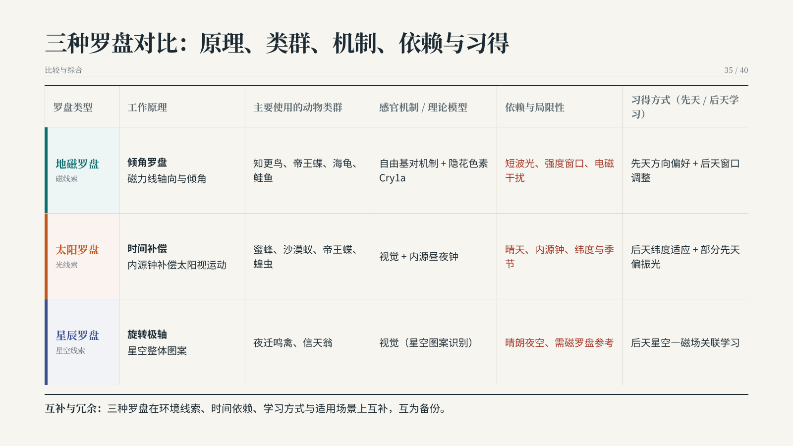

# Animal compasses · 动物罗盘

[English overview](https://github.com/G1nkgo7/MURAL-Presenter#readme-en) · [中文介绍](../../../README_zh-CN.md) · [Figure sources](../README.md)

Three original pages from a completed **40-slide Chinese teaching presentation**, generated with
**MuralPresenter-27B · Global Selective · 2 epochs / checkpoint-64**. The task asks how animals use
geomagnetic, solar and stellar cues to determine direction, for senior life-sciences undergraduates.
Click each image for the full **1600 × 900** PNG.

这三张图来自同一次已完成的 40 页中文教学演示，分别展示机制讲解、三类罗盘对比与相互校准。
均为未经重绘、裁剪或修饰的原始渲染图；点击可查看原分辨率。

## Page 19 · 太阳罗盘机制 / Sun-compass mechanism

## Page 35 · 三种罗盘对比 / Three-compass comparison

## Page 37 · 相互校准与冗余 / Calibration and redundancy

## Provenance / 来源

- **Run:** `thread35_oldpresenter_selective_ep2_tp8_20260929_r02`.
- **Model tag:** `qwen38-27b-sft-global-selective-ep2-ckpt64-tp8`.
- **Completed:** 2026-09-30 09:23:38 UTC.
- **Archived artifact inventory:** 40 HTML pages paired with 40 PNG renders; the input instruction hash matches the current case request.
- **Runtime recorded by this run:** `mural-v1-r3-bench-template-medium-20260927`. This is an archived experiment, distinct from the repository's frozen 0919 source release.
- **Publication:** three existing PNGs copied byte-for-byte and checked against the native source-run renders. [manifest.json](manifest.json) records the run, source hashes, page mapping and dimensions.

These are selected generated outputs, not a before/after revision sequence. They do not establish
that the paper's illustrative “north-to-Sun” edit occurred in this run, or that its exact Owner
assignment matches the method diagram. They are not a new benchmark result or a full-deck quality audit.

这些成品页用于展示同一任务的实际输出，不代表论文中“从正北改为太阳”的假设性修改曾在本批次执行，
也不用于证明方法示意图中的具体分组。此处未重新运行任务、修改原始结果或发布完整 benchmark 数据。
