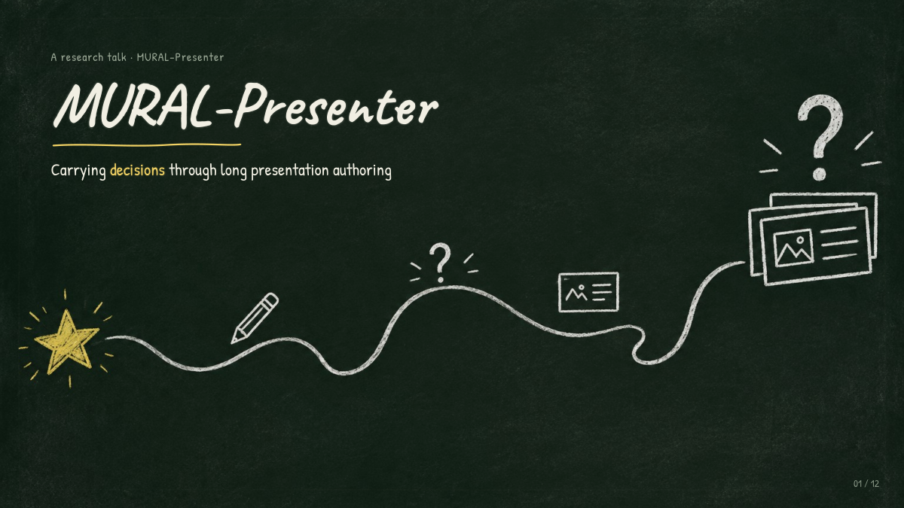
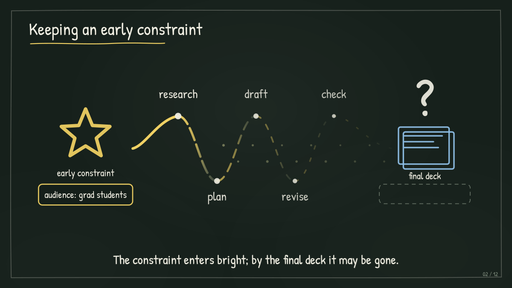
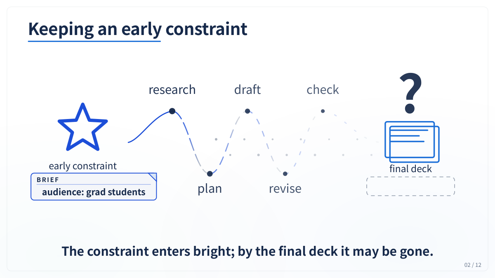
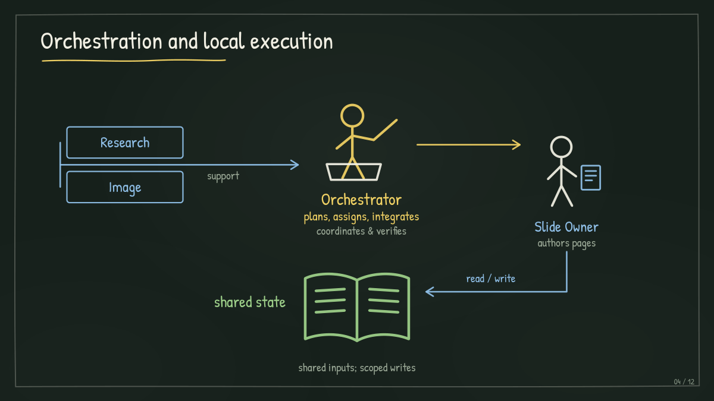
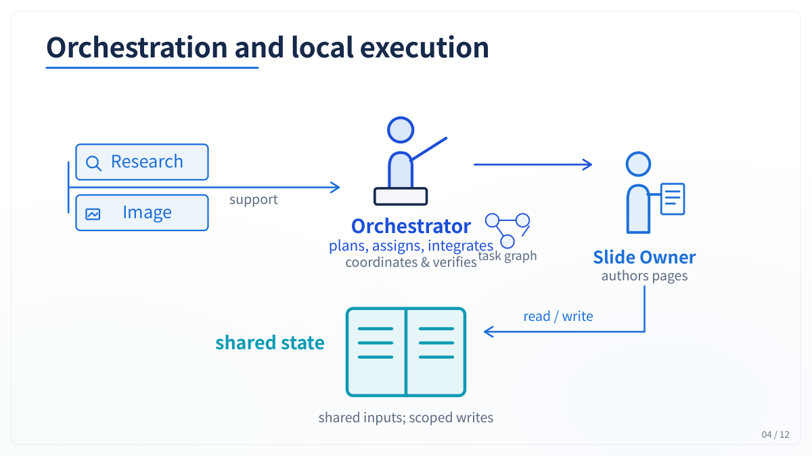
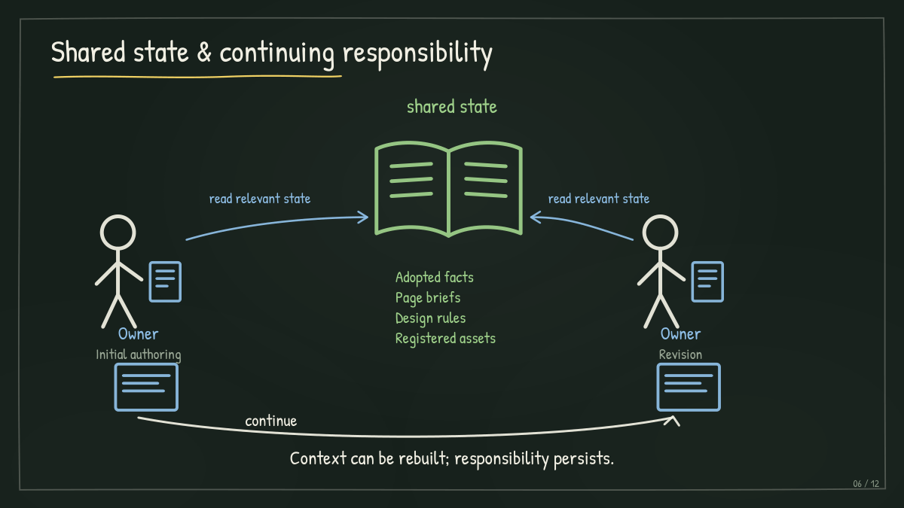
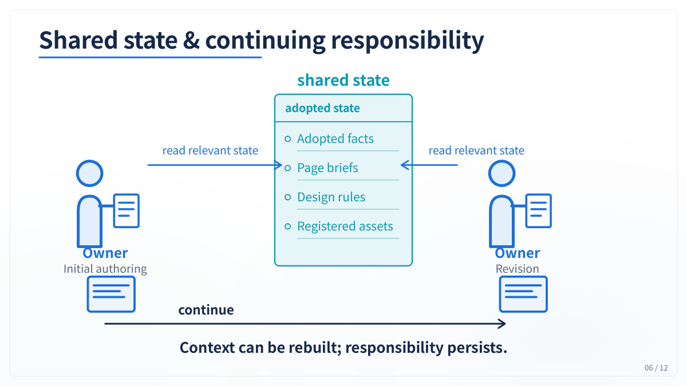

# Presentation revision · 修改前后对照

[Project overview](https://github.com/G1nkgo7/MURAL-Presenter#readme-en) · [中文介绍](https://github.com/G1nkgo7/MURAL-Presenter#readme-zh) · [Figure provenance](../README.md)

The manuscript follows a MuralPresenter-27B presentation of the paper: it expands from ten to twelve
slides, then changes from blackboard styling to light blue and white while revising explanatory diagrams.
The runtime retains assigned Owners across revisions. The six pairs below show pages 1–6 of the
same twelve-slide deck; this qualitative case is excluded from benchmark means. Click any image to enlarge.

论文案例先将演示文稿从 10 页扩展至 12 页，再修改风格和解释性图示。下方是同一份 12 页演示文稿
中第 1–6 页的前后对照，并非两份各有六页的完整演示文稿。点击图片可查看大图。

| Page / 页码 | Before · 黑板风格 | After · 浅蓝白色 |
| --- | --- | --- |
| 01 |  |  |
| 02 |  |  |
| 03 |  |  |
| 04 |  |  |
| 05 |  |  |
| 06 |  |  |

Source: `figures/revision_case.pdf`. Source pages 1–6 map to `before-01`–`before-06`;
pages 7–12 map to `after-01`–`after-06`. Exports are native-size 1,200 × 675 PNGs without cropping.
Checksums and page mappings are recorded in [manifest.json](../manifest.json).
