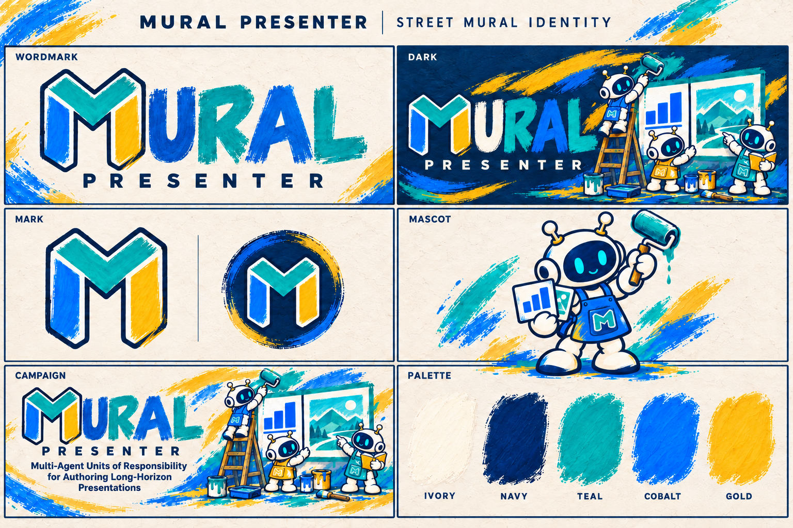

# MURAL Presenter · Street Mural Identity

The `street-v2` identity takes its direction from the author's hand-painted campaign mural:
several robot collaborators making one shared presentation. Navy ink contours, opaque paint,
teal and cobalt strokes, warm ivory and small golden-yellow accents connect every asset.

## Production assets

| Asset | Size | Background | Intended use |
| --- | --- | --- | --- |
| [Primary M mark](mural-mark.png) | 1254 × 1254 | Transparent | Compact project identity and interface mark. |
| [Avatar](mural-avatar.png) | 1254 × 1254 | Ivory | Square or circular profile display. |
| [Painter mascot](mural-mascot.png) | 1254 × 1254 | Transparent | Illustration, stickers and supporting project visuals. |
| [Light wordmark](mural-wordmark-light.png) | 2172 × 724 | Transparent | Wordmark on light surfaces. |
| [Dark wordmark](mural-wordmark-dark.png) | 2172 × 724 | Transparent | Wordmark on dark surfaces. |
| [Light banner](mural-banner-light.png) | 2172 × 724 | Ivory mural | README header and wide promotional placements. |
| [Dark banner](mural-banner-dark.png) | 2172 × 724 | Navy mural | README header in dark mode. |
| [Paper sharing card](mural-social-card.png) | 1734 × 907 | Ivory mural | Publicity graphic with the current full paper title. |
| [Identity overview](mural-brand-overview.png) | 1536 × 1024 | Ivory | Visual direction and presentation of the system. |

The individual PNGs are the production masters. The generated overview illustrates their
relationship; use the individual files for exact application artwork. Four masters have real
alpha transparency. These are raster illustrations, not editable vector artwork.

## Use and composition

- Use the M mark for small interface placements. Use the mascot where its tools and pose can remain readable.
- Keep the M a pure letterform: its central opening has no eyes, face panel or lower smile-shaped chevron.
- Draw each robot with two attached, round-tipped antennae, two solid cyan oval eyes and one small curved smile. Avoid extra antennae, detached tips and ring-shaped eyes.
- Preserve aspect ratios and leave clear space around the mark. Avoid stretching, cropping letters or placing text across the robots' faces.
- Pair the light wordmark with light surfaces and the dark wordmark with navy or similarly dark surfaces.
- The banners carry the stable name **MURAL Presenter**. Keep the full paper title as selectable text below the banner.
- The sharing card embeds **Multi-Agent Units of Responsibility for Authoring Long-Horizon Presentations**; review that wording when the manuscript title changes.
- Use one banner per placement. The light/dark pair is selected by the reader's theme, not displayed as two competing headers.

## Palette

These reference colors guide accompanying typography and layouts; hand-painted pixels vary.

| Token | Reference | Role |
| --- | --- | --- |
| Ivory | `#F7EFDC` | Light wall and paper surfaces. |
| Navy | `#102B3E` | Ink, typography and dark surfaces. |
| Teal | `#009D9A` | Primary M plane and collaborative authoring motif. |
| Cobalt | `#1476E8` | Secondary paint, charts and working clothes. |
| Gold | `#FFBD24` | Small highlights and complementary paint strokes. |

## Provenance and maintenance

Created on 2026-10-10 with the built-in `image_gen` tool, using the author's
`mural-wall-handpainted-20261008.webp` as the visual reference. Its checksum is recorded in
[manifest.json](manifest.json), alongside the dimensions, alpha status and SHA-256 of each master.
The full generation and revision prompts are retained in [generation-prompts.json](generation-prompts.json).

Revision 2 (2026-10-10) replaces the face-like M and repairs antennae and eye consistency
across all nine assets. Filenames and dimensions are unchanged, so existing README references
load the corrected artwork. The previous revision remains available in Git at
[`4b3e71a`](https://github.com/G1nkgo7/MURAL-Presenter/tree/4b3e71ad1018cadff1ccf42b8da02a2c63de5e59/assets/logo/exports/street-v2).

The root English and Chinese READMEs use the new banners. Website and WebUI application assets
are a separate integration step. Earlier PNG/SVG exports in the parent directory remain intact;
they are historical artwork and should not be mixed into new `street-v2` layouts.
Manuscript method figures retain their original scientific content and are maintained separately.

中文说明：本套包含主标识、头像、吉祥物、两版透明字标、两版横幅、论文分享图及视觉总览。
当前接入中英文 README；原网站、WebUI 与旧版素材保留，后续应用时以本目录的独立文件为准。
第 2 次修订移除了 M 内部的人脸元素，并统一机器人的双天线、椭圆眼睛；上一版可从 Git 历史恢复。
